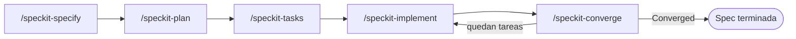
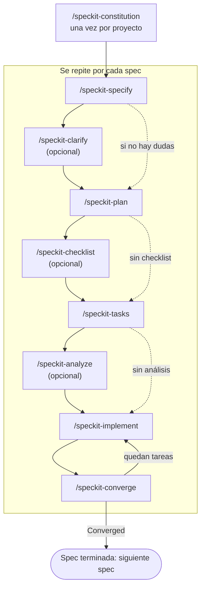
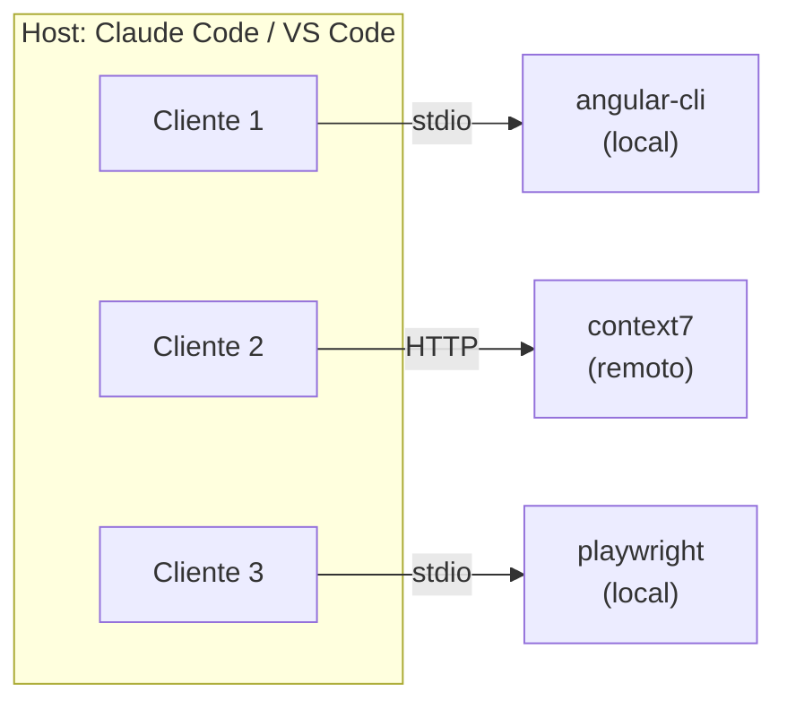
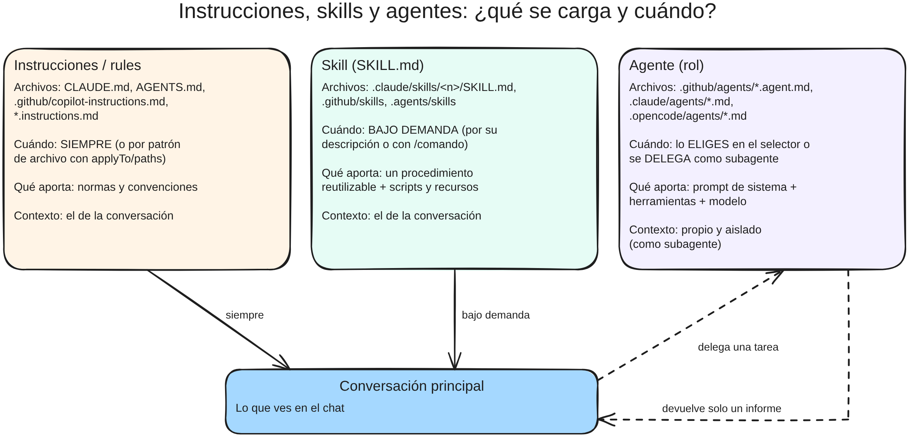
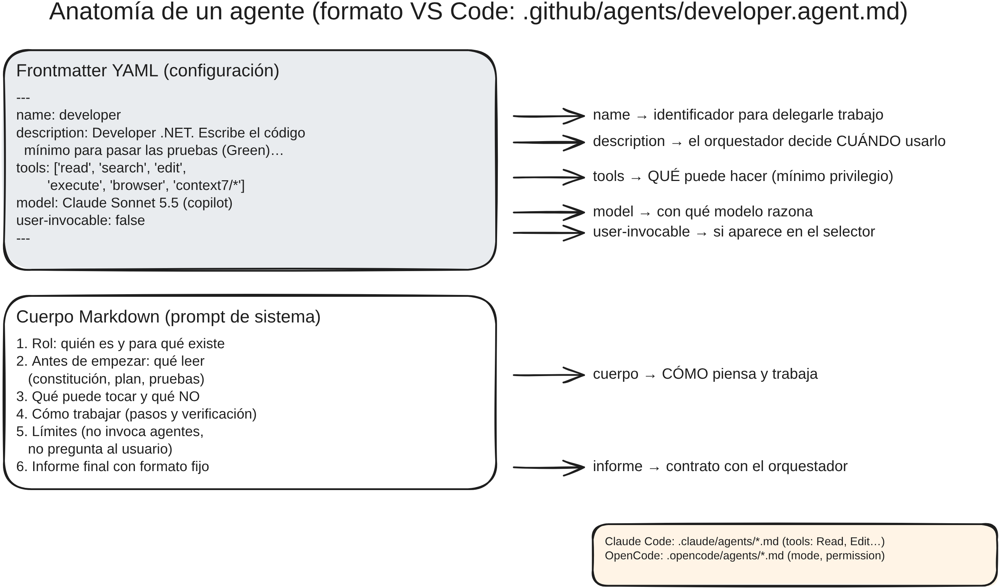
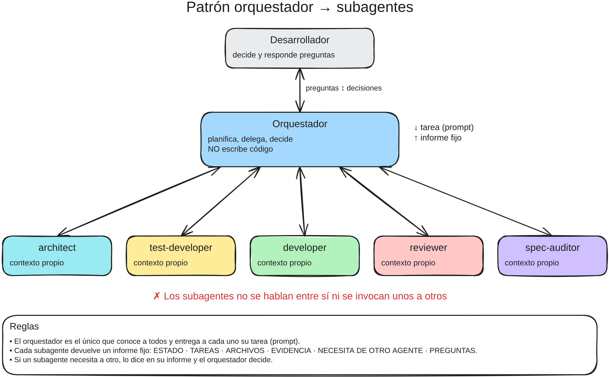
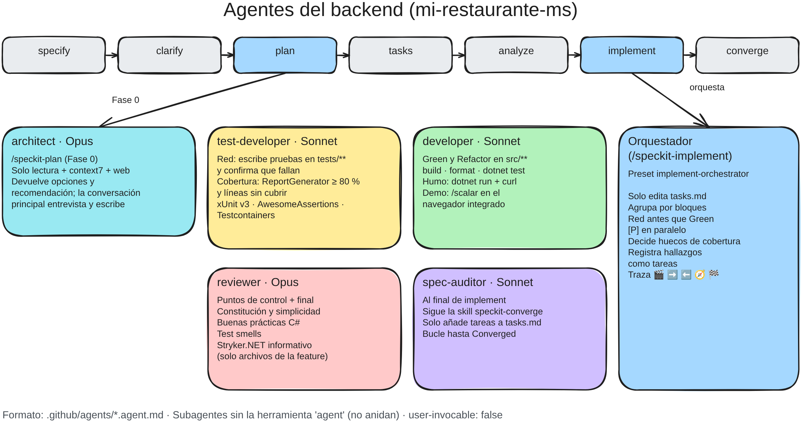
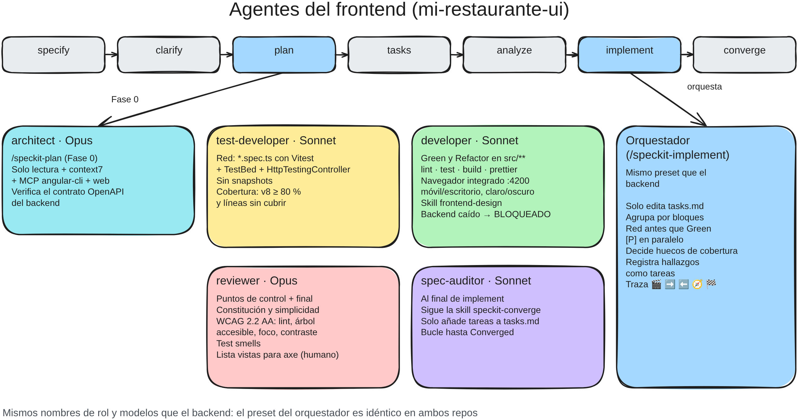
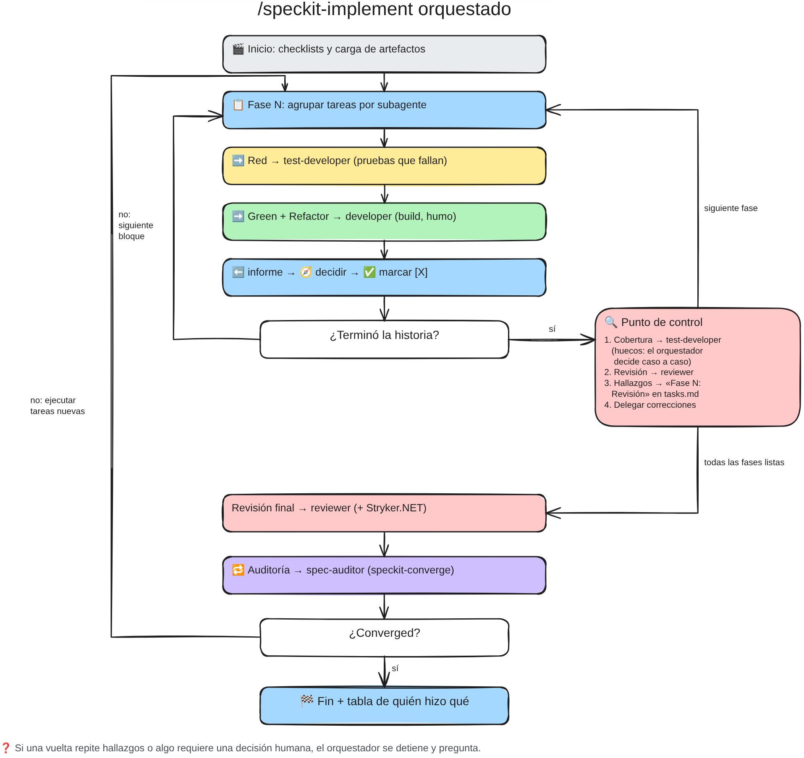

# Flujo de trabajo con Spec Kit

## Objetivo

Documentar paso a paso un flujo de trabajo con [Spec Kit](https://github.com/github/spec-kit), el toolkit open source de GitHub para desarrollo guiado por especificaciones (Spec-Driven Development, SDD) con agentes de IA de programación. El documento se irá ampliando de forma incremental, de modo que cada sección describa un paso reproducible: qué hacer, con qué comandos y cómo verificar el resultado.

## Contenido

1. [Requisito: tener instalada la skill `interview`](#1-requisito-tener-instalada-la-skill-interview)
2. [Eliminar el MCP Context7](#2-eliminar-el-mcp-context7)
3. [Instalar el MCP Context7](#3-instalar-el-mcp-context7)
4. [Crear el `CLAUDE.md` con `/init`](#4-crear-el-claudemd-con-init)
5. [Instalar Spec Kit y revisar su versión](#5-instalar-spec-kit-y-revisar-su-versión)
6. [Inicializar Spec Kit en este repositorio](#6-inicializar-spec-kit-en-este-repositorio)
7. [Revisar lo que instaló Spec Kit](#7-revisar-lo-que-instaló-spec-kit)
8. [Crear la constitución del proyecto](#8-crear-la-constitución-del-proyecto)
9. [Actualizar el `CLAUDE.md` para que conozca la constitución](#9-actualizar-el-claudemd-para-que-conozca-la-constitución)
10. [Listar las decisiones técnicas pendientes de implementar](#10-listar-las-decisiones-técnicas-pendientes-de-implementar)
11. [Flujo básico de Spec Kit para la primera spec](#11-flujo-básico-de-spec-kit-para-la-primera-spec)
12. [Flujo completo de Spec Kit](#12-flujo-completo-de-spec-kit)
13. [Modificar el comportamiento de un comando de Spec Kit](#13-modificar-el-comportamiento-de-un-comando-de-spec-kit)
14. [Repositorio propio para presets y otros componentes (informativo)](#14-repositorio-propio-para-presets-y-otros-componentes-informativo)
15. [Aseguramiento de la calidad del software generado](#15-aseguramiento-de-la-calidad-del-software-generado)
16. [MCP: qué es, dónde buscarlos y el MCP de Playwright](#16-mcp-qué-es-dónde-buscarlos-y-el-mcp-de-playwright)
17. [Agentes y subagentes en VS Code, Claude Code y OpenCode](#17-agentes-y-subagentes-en-vs-code-claude-code-y-opencode)

---

## 1. Requisito: tener instalada la skill `interview`

Para seguir este flujo se debe tener instalada la skill `interview`, que indica al agente cómo entrevistar al desarrollador hasta alcanzar un entendimiento compartido y completo de cada aspecto de la solicitud.

En este proyecto la skill se encuentra en:

```text
.claude/skills/interview/SKILL.md
```

### Verificar que está instalada

Desde la raíz del proyecto:

```bash
ls .claude/skills/interview/SKILL.md
```

El archivo debe existir y su encabezado debe declarar `name: interview`:

```yaml
---
name: interview
description: Indicaciones sobre la forma en que debe enrevistar al developer para alcanzar un entendimiento compartido y completo sobre cada aspecto de la solicitud.
---
```

Si el archivo no existe, copia la carpeta `interview/` (con su `SKILL.md`) dentro de `.claude/skills/` del proyecto antes de continuar.

---

## 2. Eliminar el MCP Context7

Antes de instalarlo desde cero, conviene eliminar cualquier instalación previa para partir de un estado limpio.

### Eliminación con la CLI

```bash
npx ctx7 remove
```

Elimina la configuración generada por `npx ctx7 setup`: el servidor MCP en los agentes configurados, la skill y las reglas asociadas. Si instalaste la CLI de forma global, quítala aparte:

```bash
npm uninstall -g ctx7
```

### Verificar que se eliminó

Busca menciones restantes en las rutas de configuración de cada agente (no debe imprimir nada):

```bash
grep -ril context7 ~/.claude.json ~/.claude/settings.json ~/.config/opencode ~/.config/Code/User/mcp.json ~/.config/Code/User/prompts ~/.agents 2>/dev/null
```

Y confirma que la CLI ya no está instalada:

```bash
which ctx7
```

Además, en VS Code el servidor `context7` ya no debe aparecer en `MCP: List Servers`.

### Eliminación manual (si `ctx7 remove` no limpia algo)

| Agente            | Qué quitar                                                                                                                                                       |
| ----------------- | ---------------------------------------------------------------------------------------------------------------------------------------------------------------- |
| VS Code / Copilot | El bloque `context7` de `servers` en `~/.config/Code/User/mcp.json` (o `.vscode/mcp.json` del proyecto) y `~/.config/Code/User/prompts/context7.instructions.md` |
| OpenCode          | La entrada `context7` de `mcp` en `~/.config/opencode/opencode.json` y su referencia en `~/.config/opencode/AGENTS.md`                                           |
| Claude Code       | `claude mcp remove context7` (con `-s user`, `-s local` o `-s project` según el ámbito)                                                                          |
| Skill             | `rm -rf ~/.agents/skills/context7-mcp`                                                                                                                           |

> Si la API key llegó a mostrarse en pantalla, en logs o en un archivo versionado, revócala en [context7.com/dashboard](https://context7.com/dashboard) y genera otra al reinstalar.

---

## 3. Instalar el MCP Context7

[Context7](https://github.com/upstash/context7) entrega al agente documentación actualizada y específica de la versión de cada librería, evitando APIs inventadas o código desactualizado. Se registra como servidor MCP para que el agente pueda llamar a sus herramientas `resolve-library-id` y `query-docs`.

### Prerrequisitos

- [Node.js 22.13+](https://nodejs.org/) (lo requiere la CLI `ctx7`).
- Una API key gratuita desde [context7.com/dashboard](https://context7.com/dashboard) (recomendada, da límites de uso más altos).

### Instalación automática (recomendada)

```bash
npx ctx7 setup
```

Autentica por OAuth, genera la API key e instala la configuración. Permite elegir entre modo **CLI + Skills** o modo **MCP**; para este flujo elige **MCP**. Se puede apuntar a un agente concreto con `--cursor`, `--claude` u `--opencode`.

Para quitarla, ver [Eliminar el MCP Context7](#2-eliminar-el-mcp-context7).

### Instalación manual

Configura en tu cliente MCP la URL del servidor y envía la API key en la cabecera `Authorization`:

```text
URL:     https://mcp.context7.com/mcp
Header:  Authorization: Bearer TU_API_KEY
```

Ejemplo para VS Code (`.vscode/mcp.json`, o el `mcp.json` de usuario):

```json
{
  "servers": {
    "context7": {
      "type": "http",
      "url": "https://mcp.context7.com/mcp",
      "headers": {
        "Authorization": "Bearer TU_API_KEY"
      }
    }
  }
}
```

> No subas la API key al repositorio. Si el archivo está versionado, usa una variable de entrada o de entorno en lugar del valor literal.

Instrucciones para otros clientes: [context7.com/docs/resources/all-clients](https://context7.com/docs/resources/all-clients). También está disponible la [extensión de VS Code](https://marketplace.visualstudio.com/items?itemName=Upstash.context7-mcp).

### Verificar el funcionamiento

1. Confirma que el servidor `context7` aparece en la lista de servidores MCP del agente y está iniciado.
2. Haz una consulta que dependa de una librería, por ejemplo: `¿Cómo configuro autenticación JWT en ASP.NET Core? use context7`.
3. El agente debe invocar `resolve-library-id` y luego `query-docs`.

### Consejos de uso

- Si ya conoces la librería, indica su ID para saltar la búsqueda: `use library /vercel/next.js`.
- Para una versión concreta, menciónala en el prompt.
- Para no escribir `use context7` cada vez, agrega una regla al agente (por ejemplo en `CLAUDE.md`): _"Usa siempre Context7 cuando necesite documentación de librerías o APIs, generación de código o pasos de configuración."_

---

## 4. Crear el `CLAUDE.md` con `/init`

`CLAUDE.md` es el archivo de contexto que Claude Code lee al iniciar cada sesión en el proyecto. Se genera con el comando `/init` del harness de Claude Code, apoyándose en la skill `interview` para que el agente entreviste al desarrollador en lugar de asumir decisiones.

### Prerrequisitos

- Claude Code instalado y abierto en la raíz del proyecto.
- La skill `interview` disponible en `.claude/skills/interview/SKILL.md` (ver [sección 1](#1-requisito-tener-instalada-la-skill-interview)).

### Generar el archivo

1. Abre Claude Code en la raíz del proyecto:

   ```bash
   claude
   ```

2. Ejecuta `/init` referenciando la skill con `@` y pidiendo el resultado en español:

   ```text
   /init usa la skill @.claude/skills/interview/SKILL.md para crear CLAUDE.md en español
   ```

   Al escribir `@` Claude Code ofrece autocompletar la ruta; basta con seleccionar `SKILL.md` de `interview`.

3. Responde las preguntas que haga el agente. Según la skill, recorre las decisiones una por una y explora el código antes de preguntar lo que pueda averiguar solo.

4. Revisa el `CLAUDE.md` propuesto antes de aceptarlo.

### Verificar el resultado

```bash
ls CLAUDE.md
```

El archivo debe existir en la raíz, estar redactado en español y reflejar la estructura real del proyecto (`src/`, `tests/`, solución `MiRestaurante.slnx`).

---

## 5. Instalar Spec Kit y revisar su versión

### Prerrequisitos

- Linux, macOS o Windows.
- [Python 3.11+](https://www.python.org/downloads/).
- [uv](https://docs.astral.sh/uv/) (recomendado) o [pipx](https://pipx.pypa.io/).
- Un agente de programación con IA soportado (por ejemplo GitHub Copilot, Claude Code o Gemini CLI).
- Git (opcional; solo si se habilita la extensión de git).

### Instalación

Instalación persistente con `uv` desde PyPI:

```bash
uv tool install specify-cli
```

Alternativas:

```bash
# Con pipx
pipx install specify-cli

# Con pip
pip install specify-cli

# Fijar una versión concreta
uv tool install specify-cli==X.Y.Z

# Desde GitHub, fijado a un tag de release (conservar la "v" inicial)
uv tool install specify-cli --from git+https://github.com/github/spec-kit.git@vX.Y.Z
```

> Si `specify-cli` ya está instalado, estos comandos conservan la versión existente. Para reemplazarla, usa la misma herramienta con la que se instaló, por ejemplo `uv tool install --force specify-cli`. Mezclar instaladores puede dejar dos copias y que `specify` apunte a la antigua.

### Revisar la versión

```bash
specify version
```

Confirma que el comando `specify` está disponible y muestra su versión. No indica si el ejecutable vino de PyPI o de GitHub.

Para saber si existe una versión más reciente (solo lectura, no modifica la instalación):

```bash
specify self check
```

---

## 6. Inicializar Spec Kit en este repositorio

Instalar la CLI (sección anterior) solo deja disponible el comando `specify`. Para usar Spec Kit en el proyecto hay que inicializarlo en la raíz del repositorio, que ya tiene código.

### 1. Inicializar

Desde la raíz del repositorio:

```bash
specify init --here
```

`--here` inicializa en el directorio actual en lugar de crear uno nuevo.

Al no indicar la integración, la consola pide elegir en qué herramientas de IA instalar Spec Kit (Claude, GitHub Copilot, Gemini, OpenCode, etc.). Selecciona las que uses.

Esto agrega los archivos compartidos en `.specify/` y los archivos de comandos o skills de cada integración elegida. No modifica el código de la aplicación.

### 2. Verificar

```bash
specify version
ls .specify
```

Al abrir Claude Code en el proyecto deben estar disponibles los comandos de Spec Kit (`constitution`, `specify`, `clarify`, `plan`, `tasks`, `analyze`, `implement`, `converge`).

---

## 7. Revisar lo que instaló Spec Kit

Estructura de carpetas resultante en la raíz del repositorio (se omiten `src/`, `tests/`, `bin/` y `obj/`):

```text
mi-restaurante-ms/
├── CLAUDE.md
├── .claude/
│   └── skills/
│       ├── interview/
│       │   └── SKILL.md
│       ├── speckit-analyze/
│       │   └── SKILL.md
│       ├── speckit-checklist/
│       │   └── SKILL.md
│       ├── speckit-clarify/
│       │   └── SKILL.md
│       ├── speckit-constitution/
│       │   └── SKILL.md
│       ├── speckit-converge/
│       │   └── SKILL.md
│       ├── speckit-implement/
│       │   └── SKILL.md
│       ├── speckit-plan/
│       │   └── SKILL.md
│       ├── speckit-specify/
│       │   └── SKILL.md
│       ├── speckit-tasks/
│       │   └── SKILL.md
│       └── speckit-taskstoissues/
│           └── SKILL.md
└── .specify/
    ├── .gitignore
    ├── init-options.json
    ├── integration.json
    ├── integrations/
    │   ├── claude.manifest.json
    │   └── speckit.manifest.json
    ├── memory/
    │   ├── .constitution-template.json
    │   └── constitution.md
    ├── scripts/
    │   └── bash/
    │       ├── check-prerequisites.sh
    │       ├── common.sh
    │       ├── create-new-feature.sh
    │       ├── resolve-template.sh
    │       ├── setup-plan.sh
    │       └── setup-tasks.sh
    ├── templates/
    │   ├── checklist-template.md
    │   ├── constitution-template.md
    │   ├── plan-template.md
    │   ├── spec-template.md
    │   └── tasks-template.md
    └── workflows/
        ├── workflow-registry.json
        └── speckit/
            └── workflow.yml
```

---

## 8. Crear la constitución del proyecto

La constitución recoge los principios y las decisiones técnicas que gobiernan el proyecto; las fases posteriores (spec, plan, tasks) deben respetarla. Se crea una sola vez por proyecto con el comando `/speckit-constitution` en el chat de Claude Code (no en la terminal), y el resultado se guarda en `.specify/memory/constitution.md`.

Se documentan dos prompts, según cuánto se tenga decidido de antemano. Ambos se envían a continuación de `/speckit-constitution`.

| Prompt                                                                                                                                      | Cuándo usarlo                                                                                                        |
| ------------------------------------------------------------------------------------------------------------------------------------------- | -------------------------------------------------------------------------------------------------------------------- |
| [Prompt final para mi-restaurante-ms](#prompt-final-para-mi-restaurante-ms)                                                                 | Las decisiones técnicas ya están tomadas y solo hay que plasmarlas.                                                  |
| [Prompt genérico cuando no se conoce las decisiones técnicas a tomar](#prompt-genérico-cuando-no-se-conoce-las-decisiones-técnicas-a-tomar) | Se tiene poca claridad técnica; el agente investiga, propone y acuerda las decisiones por bloques antes de redactar. |

### Prompt final para mi-restaurante-ms

```markdown
/speckit-constitution Crea la constitución del proyecto MiRestaurante (repositorio mi-restaurante-ms). Redáctala en español. Cada principio debe usar lenguaje normativo en mayúsculas: DEBE (MUST, obligatorio), NO DEBE (MUST NOT, prohibido) y DEBERÍA (SHOULD, recomendado salvo justificación), y explicar brevemente su razón. El principio rector, por encima de los demás, es la SIMPLICIDAD: ante dos alternativas válidas se elige la que tenga menos piezas, menos dependencias y menos conceptos, y toda complejidad adicional debe justificarse en la tabla Complexity Tracking del plan.

- Usa la skill **interview** para alcanzar un entendimiento compartido y completo sobre cada aspecto de esta solicitud
- Usa el MCP **context7** para librerías y frameworks.
- Usa búsqueda web para estándares.
- No te bases solo en tu entrenamiento. Indica la versión actual de cada herramienta y advierte sobre paquetes abandonados.

## Contexto del producto

- Una única API web REST que muestra el menú de un restaurante y permite hacer pedidos.
- El sufijo "-ms" anticipa que podrán nacer otros microservicios en el futuro, pero hoy existe un solo servicio, con un solo despliegue y una sola base de datos. No se introduce mensajería, eventos de integración ni comunicación entre servicios hasta que una spec lo requiera.

## I. Arquitectura limpia en cuatro capas

- Solución existente: MiRestaurante.slnx con src/MiRestaurante.Domain, src/MiRestaurante.Application, src/MiRestaurante.Infrastructure y src/MiRestaurante.Api, sobre .NET 10 (SDK fijado en global.json).
- Regla de dependencias: Domain ← Application ← Infrastructure; Api es la raíz de composición y referencia Application e Infrastructure.
- Domain NO DEBE tener dependencias de paquetes NuGet ni de otros proyectos.
- Application DEBE depender solo de Domain y de las abstracciones de Entity Framework Core necesarias para declarar IApplicationDbContext. NO DEBE referenciar Infrastructure ni Api.
- Infrastructure implementa las interfaces declaradas en Application.
- Los controladores NO DEBEN contener lógica de negocio ni acceder directamente a Infrastructure.

## II. Modelo de dominio simple

- Entidades simples (modelo anémico) con propiedades públicas. No se usan agregados, value objects, eventos de dominio ni especificaciones DDD.
- Identificadores: int autoincremental.
- Fechas y horas: DateTimeOffset almacenado en UTC (timestamptz en PostgreSQL). La hora actual se obtiene SIEMPRE de un TimeProvider inyectado, nunca de DateTime.Now ni DateTime.UtcNow directamente, para poder controlarla en las pruebas.
- Precios: decimal con precisión (10,2), en una única moneda implícita (pesos colombianos, COP). Prohibido float o double para valores monetarios.

## III. Capa de aplicación con servicios clásicos

- Los casos de uso se implementan como servicios de aplicación por área funcional (por ejemplo IMenuService/MenuService, IOrderService/OrderService), con un método por caso de uso, registrados en el contenedor de DI e inyectados en los controladores.
- No se usa CQRS, mediador (MediatR, Mediator, Cortex.Mediator ni similares) ni librerías de pipeline.
- El mapeo entre entidades y DTOs es manual (métodos de extensión ToDto() o constructores de DTO). Prohibidos los mapeadores automáticos (AutoMapper, Mapster, Mapperly).
- Los servicios NO DEBEN devolver entidades de dominio a la capa Api; devuelven DTOs.
- La validación de entrada usa DataAnnotations sobre los DTOs de entrada ([Required], [Range], [MaxLength]…), con mensajes en español. Las reglas de negocio (por ejemplo, no pedir un plato no disponible) se validan en el servicio, no en atributos.

## IV. Acceso a datos con Entity Framework Core y PostgreSQL

- ORM: Entity Framework Core con el proveedor Npgsql (Npgsql.EntityFrameworkCore.PostgreSQL). Base de datos: PostgreSQL.
- Application declara la interfaz IApplicationDbContext (DbSet<T> y SaveChangesAsync). Infrastructure la implementa en el DbContext concreto. No se crean repositorios genéricos ni específicos ni una Unit of Work propia: el DbContext cumple ese papel.
- La configuración del modelo usa clases IEntityTypeConfiguration<T> en Infrastructure, no atributos de mapeo en las entidades de Domain.
- El esquema se gestiona exclusivamente con migraciones de EF Core versionadas en Infrastructure. Prohibido escribir DDL a mano.
- Las migraciones se aplican automáticamente al iniciar la API solo en el entorno Development. Para cualquier otro entorno se genera un script idempotente (dotnet ef migrations script --idempotent).
- Los datos iniciales del menú se cargan con HasData en la configuración del modelo, de modo que forman parte de las migraciones.
- Prohibido construir SQL concatenando o interpolando valores; si alguna vez se necesita SQL explícito, DEBEN usarse las variantes parametrizadas de EF Core.

## V. Convenciones de la API HTTP

- Controladores MVC con [ApiController]; no se usan Minimal APIs ni FastEndpoints.
- Todas las rutas llevan el prefijo fijo /api/v1/ (por ejemplo [Route("api/v1/[controller]")]).
- Documento OpenAPI generado de forma nativa con Microsoft.AspNetCore.OpenApi (AddOpenApi/MapOpenApi) e interfaz interactiva con Scalar (Scalar.AspNetCore). No se usa Swashbuckle.
- Cada acción declara sus códigos de respuesta con [ProducesResponseType]. No se exigen comentarios de documentación XML.
- Manejo de errores: los servicios lanzan excepciones propias con significado de negocio (por ejemplo NotFoundException → 404, BusinessRuleException → 409/422). Un único IExceptionHandler nativo las traduce a ProblemDetails (RFC 9457) junto con AddProblemDetails(). Los controladores NO DEBEN contener try/catch. Los errores de validación de DataAnnotations responden 400 automáticamente gracias a [ApiController].
- Endpoint de salud /health con verificación de la conexión a la base de datos (AddDbContextCheck).
- CORS abierto (cualquier origen, método y cabecera) únicamente en el entorno Development.

## VI. Desarrollo guiado por pruebas (NO NEGOCIABLE)

- TDD obligatorio para todo código nuevo: Red (escribir una prueba y verla fallar al ejecutarse) → Green (mínimo código para que pase) → Refactor (limpiar sin romper pruebas). En tasks.md la tarea de prueba DEBE preceder a la de implementación.
- Cobertura mínima del 80 % de líneas sobre el conjunto de la solución, medida con coverlet.MTP al ejecutar dotnet test --coverlet.
- Herramientas: xUnit v3 (paquete xunit.v3) ejecutado sobre Microsoft.Testing.Platform (modo MTP de dotnet test activado en global.json con "test": { "runner": "Microsoft.Testing.Platform" }; cada proyecto de pruebas es ejecutable, OutputType Exe; no se mezcla con VSTest ni con xUnit v2, por lo que los proyectos de pruebas NO DEBEN referenciar Microsoft.NET.Test.Sdk ni xunit.runner.visualstudio), AwesomeAssertions para aserciones y Moq para dobles de prueba.
- Proyectos de prueba y responsabilidad de cada uno:
  - tests/MiRestaurante.Domain.UnitTests: pruebas unitarias de Domain.
  - tests/MiRestaurante.Application.UnitTests: pruebas unitarias de servicios de aplicación y validaciones. Moq se usa para dependencias como TimeProvider u otras interfaces; NO DEBEN simularse DbSet ni el DbContext con Moq. La lógica que depende de IApplicationDbContext se prueba contra PostgreSQL real.
  - tests/MiRestaurante.Infrastructure.IntegrationTests: pruebas de persistencia contra PostgreSQL real.
  - tests/MiRestaurante.Api.FunctionalTests: pruebas de extremo a extremo de los endpoints con WebApplicationFactory.
  - tests/MiRestaurante.Architecture.Tests (ya implementado): pruebas de arquitectura con NetArchTest.Rules que verifican la regla de dependencias del principio I, que los controladores no dependan de Infrastructure y que Domain solo referencie ensamblados del framework. Toda regla nueva de dependencias DEBE agregarse aquí como prueba.
- Las pruebas contra base de datos usan Testcontainers.PostgreSql. El esquema se crea aplicando las migraciones reales de EF Core, y Respawn limpia los datos entre pruebas. Prohibidos el proveedor InMemory de EF Core y SQLite como sustitutos de PostgreSQL.
- Nomenclatura: clase {Sujeto}Tests; método {Metodo}_Should_{Resultado}_When_{Escenario}. Una aserción lógica por prueba; sin lógica condicional (if, switch, bucles) dentro de las pruebas; los escenarios parametrizados usan [Theory] con [InlineData].

## VII. Convenciones de código e idioma

- Se siguen las C# Coding Conventions oficiales de Microsoft, con este núcleo obligatorio: namespaces de ámbito de archivo, Nullable habilitado, async/await con CancellationToken propagado en todo I/O (prohibidos .Result y .Wait()) e inyección de dependencias por constructor (se permiten constructores primarios).
- Idioma: código, identificadores, rutas de la API y propiedades JSON en inglés (por ejemplo Dish, Order, /api/v1/orders). Mensajes dirigidos al usuario, documentación y artefactos de Spec Kit (spec, plan, tasks) en español.

## VIII. Entorno de desarrollo local

- Un archivo compose.yaml de Docker Compose levanta únicamente PostgreSQL. La API se ejecuta con dotnet run o desde el IDE.
- La cadena de conexión de desarrollo apunta al contenedor de Docker Compose.
```

### Prompt genérico cuando no se conoce las decisiones técnicas a tomar

Prompt base recomendado cuando hay poca claridad sobre las decisiones técnicas. Trabaja en dos fases: primero acuerda las decisiones con el desarrollador y solo después redacta la constitución.

```markdown
## Objetivo

Crea la constitución de este repositorio. Trabaja en dos fases y no pases a la siguiente sin mi aprobación explícita:

- **Fase 1:** acordar conmigo las decisiones técnicas.
- **Fase 2:** redactar la constitución solo con lo aprobado.

## Producto

Una única API web REST que muestra el menú de un restaurante y permite hacer pedidos.

## Decisiones técnicas

1. Revisa todo el repositorio (código, proyectos, configuración, dependencias, pruebas y documentación) para que tengas claridad de

- las decisiones que ya están tomadas;
- las inconsistencias o deuda que encuentres;
- las decisiones que faltan.

<!-- Si tienes en mente algunas decisiones técnicas que quieras incluir puedes hacerlo aquí -->

2. Verifica cada decisión tomada o propuesta que vas a realizar con la documentación oficial y vigente:

- Usa el MCP **context7** para librerías y frameworks.
- Usa búsqueda web para estándares.
- No te bases solo en tu entrenamiento. Indica la versión actual de cada herramienta y advierte sobre paquetes abandonados.

3. Preséntame las decisiones **por bloques temáticos** y espera mi respuesta antes de seguir con el siguiente bloque. No asumas nada que yo no haya aprobado.
4. Lo que yo decida posponer no se descarta: va a la sección "Fuera del alcance actual" de la constitución.

## Restricciones

- El principio rector es la simplicidad: ante dos opciones válidas, recomienda la que tenga menos piezas, dependencias y conceptos. Toda complejidad adicional debe justificarse.
- Evita el sobrediseño para el tamaño real del producto.
- No escribas ni modifiques código, configuración ni dependencias. Esta tarea solo produce la constitución.
- Redacta la constitución en español. Los nombres de tecnologías, paquetes e identificadores van en su forma original.
- Cada principio debe usar lenguaje normativo en mayúsculas: DEBE (MUST, obligatorio), NO DEBE (MUST NOT, prohibido) y DEBERÍA (SHOULD, recomendado salvo justificación), y explicar brevemente su razón
- Usa la skill @interview para alcanzar un entendimiento compartido y completo sobre cada aspecto de esta solicitud
```

### Verificar el resultado

La constitución queda en `.specify/memory/constitution.md`. Debe estar en español, usar lenguaje normativo (DEBE / NO DEBE / DEBERÍA) y no conservar marcadores de plantilla sin completar.

---

## 9. Actualizar el `CLAUDE.md` para que conozca la constitución

Las skills `speckit-*` leen `.specify/memory/constitution.md` por su cuenta, pero una conversación normal con la IA (sin comandos de Spec Kit) no la carga. Como Claude Code sí lee `CLAUDE.md` al iniciar cada sesión, basta con que este archivo la referencie para que la IA la conozca siempre.

El mecanismo es una importación con `@` dentro de `CLAUDE.md`: la línea `@.specify/memory/constitution.md` carga el contenido de la constitución en el contexto, sin copiarlo (así no se desincroniza cuando la constitución cambie).

### Prompt

Envía este prompt en el chat de Claude Code, como mensaje normal (no es un comando de Spec Kit):

```markdown
Actualiza el CLAUDE.md para que, en cualquier conversación con IA, aunque no se use un comando de Spec Kit, la IA conozca y respete la constitución del proyecto (@.specify/memory/constitution.md).

- Usa la skill @.claude/skills/interview/SKILL.md para alcanzar un entendimiento compartido y completo sobre cada aspecto de esta solicitud.

## Qué debe hacer el CLAUDE.md

1. Importar la constitución con la sintaxis `@.specify/memory/constitution.md`, en una sección propia cerca del inicio. No copies ni resumas su contenido: debe cargarse desde el archivo para no desincronizarse.
2. Indicar que la constitución es la fuente única de verdad y que, ante cualquier conflicto con otras instrucciones del CLAUDE.md, prevalece la constitución.
3. Indicar que, antes de proponer o escribir código, la IA debe verificar que su propuesta cumple la constitución, y que si una petición la contradice debe advertirlo en lugar de ejecutarla en silencio.
4. Indicar que no se debe editar `.specify/memory/constitution.md` salvo con el comando `/speckit-constitution`.

## Consistencia con la constitución

- Revisa el resto del CLAUDE.md contra la constitución y corrige o elimina lo que la contradiga (por ejemplo, tecnologías, convenciones o reglas distintas).
- No dupliques en el CLAUDE.md reglas que ya estén en la constitución; déjalas solo en ella.
- Conserva lo que sea útil y no esté en la constitución (por ejemplo, comandos de compilación, pruebas y ejecución).

## Restricciones

- Redacta el CLAUDE.md en español. Los nombres de tecnologías, paquetes, comandos e identificadores van en su forma original.
- Mantén el archivo breve; no agregues información que la IA pueda deducir leyendo el código.
- Modifica únicamente el CLAUDE.md. No cambies código, configuración, dependencias ni la constitución.
- Muéstrame los cambios propuestos y espera mi aprobación antes de guardarlos.
```

### Verificar el resultado

1. El `CLAUDE.md` debe contener la línea de importación:

   ```bash
   grep -n "@.specify/memory/constitution.md" CLAUDE.md
   ```

2. En una sesión nueva de Claude Code, ejecuta `/memory`: la constitución debe aparecer entre los archivos cargados.
3. Pregunta sin usar ningún comando de Spec Kit, por ejemplo: `¿Qué base de datos y qué herramientas de pruebas debe usar este proyecto?`. La respuesta debe coincidir con la constitución.

---

## 10. Listar las decisiones técnicas pendientes de implementar

La constitución documenta decisiones que el repositorio aún no refleja. Cada una de esas diferencias es candidata a convertirse en una spec.

Para este paso vuelve al chat donde se creó la constitución (sección 8): ese chat ya conoce el contexto, las decisiones acordadas y lo que se pospuso.

### Prompt

```markdown
Crea una lista de todas las decisiones técnicas que están documentadas y no implementadas en el repositorio para que yo pueda empezar a crear specs con cada una de ellas
```

### Verificar el resultado

La lista debe contener decisiones de la constitución que no existen en el código (por ejemplo, paquetes, proyectos o archivos que la constitución exige y el repositorio no tiene). Cada ítem debe poder convertirse después en una spec.

---

## 11. Flujo básico de Spec Kit para la primera spec

Cada decisión técnica pendiente de la lista anterior se construye como una spec. La primera sigue el flujo más básico de Spec Kit. La constitución (sección 8) se crea una sola vez por proyecto; los pasos siguientes se repiten por cada spec.



Reglas generales:

- Los comandos se ejecutan en el chat de Claude Code, no en la terminal, de uno en uno.
- Revisa el resultado de cada comando antes de lanzar el siguiente: cada uno toma como entrada lo que generó el anterior.
- Todos leen `.specify/memory/constitution.md`, así que la constitución gobierna cada fase.
- Los artefactos de cada spec quedan en `specs/<NNN-nombre>/`, con numeración secuencial (`001-...`, `002-...`).

### 1. `/speckit-specify`: definir qué se construye y por qué

**Para qué:** convierte una descripción en lenguaje natural en una especificación: historias de usuario priorizadas, requisitos funcionales, escenarios de aceptación y criterios de éxito. Describe el **qué** y el **por qué**, no la tecnología.

**Cómo se usa:** a continuación del comando se escribe la descripción de la funcionalidad. Aquí va una de las decisiones pendientes de la lista de la sección 10:

```text
/speckit-specify <descripción de la decisión técnica pendiente: qué debe lograrse y por qué>
```

**Qué genera:**

- `specs/<NNN-nombre>/spec.md`: la especificación.
- `specs/<NNN-nombre>/checklists/requirements.md`: checklist de calidad de la spec.

**Qué revisar:**

- Que la spec no incluya detalles de implementación.
- Si quedan marcadores `[NEEDS CLARIFICATION]` (máximo 3), el agente pregunta y los reemplaza con tus respuestas.
- Que los escenarios de aceptación sean verificables.

### 2. `/speckit-plan`: decidir cómo se construye

**Para qué:** a partir de la spec y de la constitución genera el plan técnico: contexto técnico, verificación contra la constitución (_Constitution Check_), estructura del código y decisiones de diseño.

**Cómo se usa:** el argumento es opcional y sirve para orientar el plan. Como las decisiones técnicas del proyecto ya están en la constitución, basta con pedir que se respete:

```text
/speckit-plan Sigue las decisiones de la constitución; no introduzcas tecnologías nuevas.
```

**Qué genera**, en `specs/<NNN-nombre>/`:

- `plan.md`: el plan, con las tablas _Constitution Check_ y _Complexity Tracking_.
- `research.md`: investigación que resuelve las dudas técnicas.
- `data-model.md`: entidades y relaciones.
- `contracts/`: contratos de las interfaces externas (por ejemplo, endpoints), si aplica.
- `quickstart.md`: guía para validar la funcionalidad.

**Qué revisar:** que el _Constitution Check_ pase y que toda complejidad adicional esté justificada en _Complexity Tracking_, como exige el principio de simplicidad.

### 3. `/speckit-tasks`: dividir el trabajo en tareas

**Para qué:** genera la lista de tareas ejecutables, ordenadas por dependencias y agrupadas por historia de usuario, de modo que cada historia se pueda implementar y probar de forma independiente.

**Cómo se usa:** sin argumentos, o con restricciones opcionales para la generación:

```text
/speckit-tasks
```

**Qué genera:** `specs/<NNN-nombre>/tasks.md`, con tareas numeradas (`T001`, `T002`, ...), rutas de archivo concretas, marcas de paralelización y la etiqueta de historia (`[US1]`, `[US2]`, ...).

**Qué revisar:** que cada tarea sea lo bastante específica para ejecutarse sin contexto adicional y que, según la constitución (TDD), la tarea de prueba preceda a la de implementación.

### 4. `/speckit-implement`: construir

**Para qué:** ejecuta las tareas de `tasks.md` en orden, escribiendo el código, y las va marcando como completadas.

**Cómo se usa:** sin argumentos, o con una indicación opcional para filtrar qué tareas ejecutar:

```text
/speckit-implement
```

Antes de empezar revisa los checklists de `checklists/`; si hay ítems sin marcar, pregunta si se desea continuar.

**Qué revisar:** el código generado junto con los cambios en los artefactos (diff de git), y que compile y las pruebas pasen.

### 5. `/speckit-converge`: comprobar que todo quedó construido

**Para qué:** compara el código actual con la spec, el plan, las tareas y la constitución, y detecta lo que falta o contradice lo definido. No modifica `spec.md` ni `plan.md`.

**Cómo se usa:** sin argumentos, después de `/speckit-implement`:

```text
/speckit-converge
```

**Qué produce:**

- Si encuentra trabajo pendiente, lo agrega como tareas nuevas en una sección _Convergence_ al final de `tasks.md`. En ese caso se repite `/speckit-implement` y luego `/speckit-converge`.
- Si todo está construido, no cambia `tasks.md` y reporta **Converged**.

La spec está terminada cuando `/speckit-converge` reporta **Converged**.

### Comandos opcionales

No forman parte del flujo básico, pero Spec Kit los incluye: `/speckit-clarify` (resolver ambigüedades de la spec), `/speckit-checklist` (checklists de calidad de requisitos) y `/speckit-analyze` (consistencia entre spec, plan y tasks). Se detallan en la [sección 12](#12-flujo-completo-de-spec-kit).

---

## 12. Flujo completo de Spec Kit

El flujo básico (sección 11) se puede reforzar con comandos opcionales que reducen el riesgo de rehacer trabajo. Esta sección une todo en un solo recorrido.

### Visión general



### Resumen de comandos

| #   | Comando                 | Obligatorio  | Fase          | Entrada principal                         | Salida                                                                   |
| --- | ----------------------- | ------------ | ------------- | ----------------------------------------- | ------------------------------------------------------------------------ |
| 0   | `/speckit-constitution` | Sí (una vez) | Principios    | Principios y decisiones técnicas          | `.specify/memory/constitution.md`                                        |
| 1   | `/speckit-specify`      | Sí           | Qué y por qué | Descripción de la funcionalidad           | `spec.md`, `checklists/requirements.md`                                  |
| 2   | `/speckit-clarify`      | No           | Qué y por qué | `spec.md`                                 | `spec.md` actualizada                                                    |
| 3   | `/speckit-plan`         | Sí           | Cómo          | `spec.md` + constitución                  | `plan.md`, `research.md`, `data-model.md`, `contracts/`, `quickstart.md` |
| 4   | `/speckit-checklist`    | No           | Cómo          | Spec y plan                               | `checklists/<dominio>.md`                                                |
| 5   | `/speckit-tasks`        | Sí           | Tareas        | `plan.md` + `spec.md`                     | `tasks.md`                                                               |
| 6   | `/speckit-analyze`      | No           | Tareas        | `spec.md`, `plan.md`, `tasks.md`          | Informe (solo lectura)                                                   |
| 7   | `/speckit-implement`    | Sí           | Construcción  | `tasks.md`                                | Código y tareas marcadas                                                 |
| 8   | `/speckit-converge`     | Sí           | Cierre        | Código + `spec.md`, `plan.md`, `tasks.md` | Tareas nuevas o **Converged**                                            |

Los artefactos de cada spec viven en `specs/<NNN-nombre>/`. Los comandos 1, 3, 5, 7 y 8 se explican en la [sección 11](#11-flujo-básico-de-spec-kit-para-la-primera-spec); la constitución, en la [sección 8](#8-crear-la-constitución-del-proyecto). A continuación se detallan los opcionales.

### `/speckit-clarify`: resolver ambigüedades de la spec

- **Cuándo:** después de `/speckit-specify` y **antes** de `/speckit-plan`, para evitar rehacer el plan por una spec ambigua.
- **Para qué:** detecta zonas poco definidas de la spec y hace hasta 5 preguntas dirigidas, de una en una, con una opción recomendada y razonamiento.
- **Cómo se usa:** sin argumentos, o indicando áreas a aclarar. Se responde con la letra de la opción, con `yes` o `recommended` para aceptar la recomendación, o con una respuesta corta propia.

  ```text
  /speckit-clarify
  ```

- **Resultado:** las respuestas se integran en `spec.md`, en una sección `## Clarifications` con la sesión del día.

### `/speckit-checklist`: checklists de calidad de requisitos

- **Cuándo:** después de `/speckit-plan` y antes de `/speckit-implement`.
- **Para qué:** genera checklists que actúan como «suites de pruebas unitarias para los requisitos»: no comprueban el código, sino que la spec y el plan estén completos, claros y consistentes en un dominio concreto (UX, API, seguridad...).
- **Cómo se usa:** el argumento indica el dominio o el área de enfoque.

  ```text
  /speckit-checklist seguridad
  ```

- **Resultado:** archivos como `checklists/ux.md`, `checklists/api.md` o `checklists/security.md`, que revisa una persona. Si quedan ítems sin marcar, `/speckit-implement` pregunta si se desea continuar.

### `/speckit-analyze`: consistencia entre spec, plan y tasks

- **Cuándo:** después de `/speckit-tasks` y antes de `/speckit-implement`.
- **Para qué:** revisa que `spec.md`, `plan.md` y `tasks.md` sean coherentes entre sí y con la constitución. Es de **solo lectura**: no modifica archivos.
- **Cómo se usa:** sin argumentos, o con áreas de enfoque.

  ```text
  /speckit-analyze
  ```

- **Resultado:** un informe con hallazgos por severidad. Cualquier conflicto con la constitución es **CRITICAL**; si existen hallazgos críticos se recomienda resolverlos antes de implementar. Ofrece proponer correcciones, pero no las aplica solo.

### `/speckit-taskstoissues` (obsoleto)

Convierte las tareas de `tasks.md` en issues de GitHub. Está marcado como obsoleto y se eliminará en una versión menor futura; en su lugar se usa la extensión `github`:

```bash
specify extension add github
```

y luego `/speckit-github-taskstoissues`. Solo aplica si el remoto del repositorio es de GitHub.

### Recorrido completo de una spec

```text
/speckit-specify <descripción>      -> revisar spec.md
/speckit-clarify                     -> (opcional) responder las preguntas
/speckit-plan                        -> revisar Constitution Check
/speckit-checklist <dominio>         -> (opcional) revisar checklists
/speckit-tasks                       -> revisar tasks.md
/speckit-analyze                     -> (opcional) corregir hallazgos CRITICAL
/speckit-implement                   -> revisar el código
/speckit-converge                    -> repetir implement + converge hasta "Converged"
```

Al terminar, se pasa a la siguiente decisión pendiente de la lista de la [sección 10](#10-listar-las-decisiones-técnicas-pendientes-de-implementar) y se repite desde `/speckit-specify`.

---

## 13. Modificar el comportamiento de un comando de Spec Kit

Ejemplo: lograr que `/speckit-specify` use **siempre** la skill `interview`, sin tener que pedirlo en cada prompt.

### Qué no hacer

No edites directamente `.claude/skills/speckit-specify/SKILL.md`. Ese archivo no es la fuente del comando: Spec Kit lo genera (materializa) a partir de sus capas al instalar y al reconciliar componentes, así que un cambio manual se puede perder al reinstalar, actualizar o quitar un preset. La forma soportada de cambiarlo es agregar una capa propia.

### Qué bloque de personalización usar

| Necesidad                                                        | Bloque                                                   |
| ---------------------------------------------------------------- | -------------------------------------------------------- |
| Cambiar las instrucciones de un comando existente (nuestro caso) | **Preset** con un comando que lo sobrescribe o lo amplía |
| Cambiar el formato o la terminología de spec, plan o tasks       | **Preset** con plantillas                                |
| Ajuste puntual de una plantilla en un solo proyecto              | Override local en `.specify/templates/overrides/`        |
| Agregar un comando o proceso nuevo                               | **Extensión** (`specify extension add`)                  |

Orden de resolución (gana la capa más alta): override local del proyecto, presets instalados (por prioridad), extensiones instaladas y, por último, los valores por defecto del núcleo. Los comandos se materializan como skills del agente al instalar el preset; el agente no vuelve a resolver las capas en cada invocación.

### Estrategias de composición

Un preset puede reemplazar un comando completo o ampliarlo sin copiarlo:

| Estrategia              | Efecto                                                                               |
| ----------------------- | ------------------------------------------------------------------------------------ |
| `replace` (por defecto) | Sustituye el comando por completo                                                    |
| `prepend`               | Coloca el contenido **antes** del comando existente                                  |
| `append`                | Coloca el contenido **después** del comando existente                                |
| `wrap`                  | Inserta el comando existente en el marcador `{CORE_TEMPLATE}` del archivo del preset |

Para este caso conviene `prepend`: la regla de la entrevista se antepone y el resto del comando original se conserva, por lo que sigue funcionando cuando Spec Kit se actualice.

### Paso 1: crear el preset

En la raíz del repositorio, dentro de una única carpeta `speckit-custom/` que agrupa las personalizaciones de Spec Kit (así quedan versionadas y no se mezclan con `src/` ni `tests/`; más adelante pueden sumarse `extensions/` y `bundles/` en la misma carpeta):

```text
speckit-custom/
└── presets/
    └── specify-interview/
        ├── preset.yml
        └── commands/
            └── speckit.specify.md
```

> No guardes la fuente dentro de `.specify/`: Spec Kit copia los presets instalados a `.specify/presets/<id>/` y esa carpeta la gestiona la CLI.

`speckit-custom/presets/specify-interview/preset.yml`:

```yaml
schema_version: "1.0"

preset:
  id: "specify-interview"
  name: "Specify con interview"
  version: "1.0.0"
  description: "Hace que /speckit-specify use siempre la skill interview"

requires:
  speckit_version: ">=1.2.0"

provides:
  templates:
    - type: "command"
      name: "speckit.specify"
      file: "commands/speckit.specify.md"
      description: "Antepone la entrevista al flujo de specify"
      strategy: "prepend"
```

- `name` es el nombre lógico del comando (`speckit.specify`), no el nombre del archivo ni de la skill.
- Las versiones van entre comillas.
- `requires.speckit_version` debe ser compatible con la versión instalada (`specify version`).

`speckit-custom/presets/specify-interview/commands/speckit.specify.md`:

```markdown
## Regla obligatoria: entrevista previa

Antes de crear o modificar la especificación, lee y sigue la skill `interview` (`.claude/skills/interview/SKILL.md`) para entrevistar al desarrollador sobre la descripción recibida, hasta alcanzar un entendimiento compartido y completo.

- No generes `spec.md` hasta haber terminado la entrevista.
- Si una pregunta se puede responder explorando el código o la constitución, hazlo en lugar de preguntar.
- Haz todas las preguntas y respuestas en español.

Cuando termine la entrevista, continúa con el resto de las instrucciones de este comando.
```

Notas sobre este archivo:

- Se referencia la skill por su nombre y ruta en texto. La sintaxis `@archivo` es de los prompts escritos en el chat; dentro de la instrucción de una skill hay que pedir explícitamente que se lea el archivo.
- No lleva encabezado YAML: con `prepend`, el comando conserva el encabezado del comando base.

### Paso 2: instalar el preset

Desde la raíz del repositorio:

```bash
specify preset add --dev ./speckit-custom/presets/specify-interview
```

`--dev` instala una **copia** de la carpeta; no queda enlazada. Después de editar el preset hay que reinstalarlo:

```bash
specify preset remove specify-interview
specify preset add --dev ./speckit-custom/presets/specify-interview
```

### Paso 3: verificar

```bash
specify preset list
specify preset resolve speckit.specify
grep -n "interview" .claude/skills/speckit-specify/SKILL.md
```

- `preset list` debe mostrar `specify-interview` instalado.
- `preset resolve speckit.specify` indica qué archivos componen el comando.
- El `grep` debe encontrar la regla de la entrevista en la skill entregada a Claude Code.

Luego ejecuta `/speckit-specify` en una sesión nueva con una descripción cualquiera: el agente debe empezar entrevistando antes de generar `spec.md`.

### Quitar el cambio

```bash
specify preset remove specify-interview
```

Elimina las skills que el preset entregó y restaura las capas restantes. Es preferible a `specify preset disable`, que excluye el preset de la resolución pero deja los archivos ya entregados.

> Los presets de terceros pueden incluir scripts y comandos ejecutables; revisa su código antes de instalarlos. Este preset es propio y solo contiene texto.

---

## 14. Repositorio propio para presets y otros componentes (informativo)

El preset de la sección 13 vive dentro de un proyecto. Si se quiere reutilizar las mismas personalizaciones en varios proyectos, o compartirlas con un equipo, conviene sacarlas a un **repositorio propio** (por ejemplo en GitHub) que contenga los presets y demás componentes de personalización, y que cada proyecto instale con un comando.

Qué puede contener:

| Componente | Para qué sirve                                                                      | Instalación              |
| ---------- | ----------------------------------------------------------------------------------- | ------------------------ |
| Preset     | Cambiar plantillas y comandos existentes                                            | `specify preset add`     |
| Extensión  | Agregar comandos, plantillas, scripts y hooks nuevos                                | `specify extension add`  |
| Bundle     | Empaquetar extensiones, presets y workflows como una configuración por rol o equipo | `specify bundle install` |

### 1. Estructura sugerida del repositorio

```text
spec-kit-custom/
├── README.md
├── LICENSE
├── presets/
│   └── specify-interview/
│       ├── preset.yml
│       └── commands/
│           └── speckit.specify.md
├── extensions/          # opcional: extensiones propias
├── bundles/             # opcional: bundles propios
└── catalog/
    └── presets.json     # opcional: catálogo para instalar por ID
```

Cada preset es una carpeta con su `preset.yml` (ver [sección 13](#13-modificar-el-comportamiento-de-un-comando-de-spec-kit)). Un archivo `.presetignore` en la raíz del preset excluye archivos de desarrollo al instalar.

### 2. Crear y publicar el repositorio

```bash
mkdir spec-kit-custom && cd spec-kit-custom
git init
# copiar aquí el contenido de speckit-custom/ (presets/, extensions/...) y el README
git add -A
git commit -m "feat: preset specify-interview"
gh repo create spec-kit-custom --public --source=. --push
```

Para versionar las publicaciones se usan etiquetas:

```bash
git tag v1.0.0
git push origin v1.0.0
```

### 3. Formas de usarlo desde un proyecto

Todos los comandos se ejecutan en un proyecto ya inicializado con `specify init`.

**A. Clonar el repositorio e instalar desde la carpeta local** (la más simple; funciona con varios presets en un solo repositorio):

```bash
git clone https://github.com/<usuario>/spec-kit-custom.git ~/spec-kit-custom
specify preset add --dev ~/spec-kit-custom/presets/specify-interview
```

`--dev` instala una copia. Para actualizar: `git pull` en el clon y luego `specify preset remove specify-interview` y `specify preset add --dev ...` de nuevo.

**B. Instalar desde un archivo comprimido por URL** (`--from`):

```bash
specify preset add --from https://github.com/<usuario>/spec-kit-custom/archive/refs/tags/v1.0.0.zip
```

Requisitos del archivo: la URL debe ser HTTPS y el `preset.yml` debe estar en la raíz del archivo o dentro de una única carpeta de primer nivel. Por eso el archivo automático de un repositorio con varios presets en `presets/` no sirve: o se usa un repositorio por preset, o se adjunta a la release de GitHub un `.zip` de cada preset, y se usa la URL de ese adjunto.

**C. Instalar por ID desde un catálogo propio**: se publica un `presets.json` y se registra en el proyecto.

```json
{
  "schema_version": "1.0",
  "updated_at": "2026-11-04T00:00:00Z",
  "presets": {
    "specify-interview": {
      "id": "specify-interview",
      "name": "Specify con interview",
      "description": "Hace que /speckit-specify use siempre la skill interview",
      "author": "<usuario>",
      "version": "1.0.0",
      "download_url": "https://github.com/<usuario>/spec-kit-specify-interview/archive/refs/tags/v1.0.0.zip",
      "repository": "https://github.com/<usuario>/spec-kit-specify-interview",
      "documentation": "https://github.com/<usuario>/spec-kit-specify-interview/blob/main/README.md",
      "license": "MIT",
      "requires": { "speckit_version": ">=1.2.0" },
      "provides": { "templates": 0, "commands": 1, "scripts": 0 },
      "tags": ["interview"]
    }
  }
}
```

```bash
specify preset catalog add https://raw.githubusercontent.com/<usuario>/spec-kit-custom/main/catalog/presets.json \
  --name mis-presets --install-allowed
specify preset catalog list
specify preset add specify-interview
```

- Agregar la primera entrada de catálogo al proyecto reemplaza el conjunto de catálogos por defecto; si se necesitan, hay que agregarlos también.
- Opcionalmente se puede incluir el campo `sha256` del archivo (`sha256sum archivo.zip`); si está, se verifica al instalar.
- Con repositorios privados hay que configurar la autenticación en `~/.specify/auth.json` (ver la referencia de autenticación de Spec Kit); nunca se ponen credenciales en el JSON ni en las URL.

### 4. Extensiones y bundles propios

Las extensiones tienen formas de instalación equivalentes:

```bash
specify extension add --dev ~/spec-kit-custom/extensions/<extension>
specify extension add --from https://github.com/<usuario>/<repo>/archive/refs/tags/v1.0.0.zip
```

Y también tienen catálogos propios (`specify extension catalog add <url> --name <nombre> --install-allowed`).

Un bundle agrupa varios componentes como una sola configuración. Se valida, se construye en un `.zip` y se instala desde una ruta local:

```bash
specify bundle validate --path ./bundles/mi-equipo
specify bundle build --path ./bundles/mi-equipo --output ./dist
specify bundle install ./dist/<id>-<version>.zip
```

El formato de `bundle.yml` y de las extensiones se explica en las guías oficiales _Developing bundles_ y _Developing extensions_.

### 5. Verificar lo instalado

```bash
specify preset list
specify preset resolve speckit.specify
```

### Buenas prácticas

- Usa etiquetas de versión (`v1.0.0`) y fija esa versión en las instalaciones, para que todos los proyectos usen lo mismo.
- Revisa el código de cualquier preset, extensión o catálogo de terceros antes de instalarlo: pueden incluir scripts y comandos ejecutables.
- Marca `--install-allowed` solo en catálogos propios o revisados; los demás se dejan solo para descubrimiento.
- Documenta en el `README.md` del repositorio qué hace cada componente y cómo instalarlo.

---

## 15. Aseguramiento de la calidad del software generado

Un agente escribe código y pruebas muy rápido, pero **que compile y que las pruebas pasen no demuestra que el software sea correcto**: las pruebas pueden ser débiles, estar vacías o comprobar lo mismo que preparan. Esta sección explica cada mecanismo de calidad, dónde se aplica en la configuración de estos dos repositorios y qué límites tiene.

| Tema                                                                                              | Dónde se aplica                                                                                                            | ¿Bloquea la integración?          |
| ------------------------------------------------------------------------------------------------- | -------------------------------------------------------------------------------------------------------------------------- | --------------------------------- |
| [Pruebas desde criterios de aceptación](#151-pruebas-generadas-desde-los-criterios-de-aceptación) | Plantilla de spec (Given/When/Then), `test-developer`, `reviewer` (_test smells_)                                          | No (revisión)                     |
| [TDD](#152-tdd-red--green--refactor)                                                              | Constitución (principio VI del backend), roles separados `test-developer` / `developer`, orden Red → Green del orquestador | No (proceso)                      |
| [Cobertura](#153-cobertura-qué-dice-y-qué-no)                                                     | ReportGenerator (backend) y Vitest (frontend) con umbral del 80 % de líneas                                                | **Sí**                            |
| [Mutation testing](#154-mutation-testing-como-criterio-de-calidad)                                | Stryker.NET en el `reviewer` y en un job aparte del CI del backend                                                         | No (informativo)                  |
| [Revisión de PR asistida por IA](#155-revisión-de-pr-asistida-por-ia)                             | Skill `/review-pr` (local) y revisor Copilot en GitHub                                                                     | No (decide el desarrollador)      |
| [CI y protección de rama](#156-integración-continua-ci-y-protección-de-rama)                      | GitHub Actions en cada PR y _ruleset_ sobre `main`                                                                         | **Sí**, si la rama está protegida |

### 15.1 Pruebas generadas desde los criterios de aceptación

**Concepto.** Cada escenario de aceptación de la spec (`Given … When … Then …`) debe convertirse en al menos una prueba que **falle si el escenario no se cumple**. Una prueba generada por IA puede pasar sin probar nada:

- **Vacía**: no tiene aserciones, o solo comprueba que «no lanza excepción».
- **Tautológica**: afirma lo mismo que acaba de preparar (crea un objeto con nombre «Sopa» y comprueba que su nombre es «Sopa», sin pasar por el código bajo prueba).
- **Solo prueba el mock**: verifica que se llamó a un doble de prueba, pero no el resultado.

**Dónde se aplica:**

- `/speckit-specify` exige escenarios de aceptación por historia (ver [specs/004-dishes-crud/spec.md](specs/004-dishes-crud/spec.md)).
- El [test-developer](.github/agents/test-developer.agent.md) escribe cada prueba para que «pueda fallar por una razón concreta del requisito» y tiene prohibidas las pruebas vacías, tautológicas o que solo verifican el mock.
- El [reviewer](.github/agents/reviewer.agent.md) revisa estos _test smells_ y otros (sin aserción, _assertion roulette_, `Skip`, reloj real, pruebas que no fallarían si se borrara el código).

**Límite.** Hoy la trazabilidad criterio → prueba **solo está documentada**: no hay una matriz que la compruebe. Mejora recomendada (no implementada, para no alargar la demostración en clase): que el informe del `test-developer` incluya una tabla `escenario de la spec → prueba` y que el `reviewer` marque como hallazgo cada escenario sin prueba.

### 15.2 TDD: Red → Green → Refactor

**Concepto.** Primero se escribe una prueba que falla (**Red**), después el código mínimo para que pase (**Green**) y por último se mejora el diseño sin cambiar el comportamiento (**Refactor**). Con IA es especialmente útil: la prueba fija el requisito **antes** de que el modelo proponga una implementación, y evita que el modelo escriba pruebas a la medida de su propio código.

**Dónde se aplica:**

- La constitución del backend declara el TDD como **no negociable** (principio VI).
- `/speckit-tasks` genera las tareas de prueba antes que las de implementación en cada historia.
- **TDD estructural**: el `test-developer` solo puede tocar `tests/**` y el `developer` solo `src/**`. Nadie puede «ajustar» una prueba para que pase.
- El orquestador de `/speckit-implement` delega siempre el bloque Red antes del Green (ver [17.8](#178-speckit-implement-como-orquestador)).
- El `test-developer` **confirma el Red**: registra si cada prueba falla por compilación o por aserción, y reporta como hallazgo una prueba que pasa antes de que exista el código.

**Límite.** La confirmación del Red la **declara el propio agente** en su informe; ninguna herramienta la comprueba de forma independiente. El historial de commits (prueba en un commit, código en el siguiente) sería la evidencia objetiva, pero el flujo actual no hace commits por tarea.

### 15.3 Cobertura: qué dice y qué no

**Concepto.** La cobertura de líneas mide **qué líneas se ejecutaron** durante las pruebas. Interpretación:

- **Cobertura baja**: es una señal fiable de que falta probar algo.
- **Cobertura alta**: **no** demuestra que las pruebas sean buenas. Una línea ejecutada por una prueba sin aserciones cuenta como cubierta.

Por eso la cobertura se usa como **suelo** (mínimo exigido), nunca como objetivo ni como prueba de calidad.

**Dónde se aplica:**

| Repo     | Herramienta                    | Umbral                                                                                    | Cómo se ejecuta                                     |
| -------- | ------------------------------ | ----------------------------------------------------------------------------------------- | --------------------------------------------------- |
| Backend  | coverlet.MTP + ReportGenerator | 80 % de líneas sobre los cuatro ensamblados de producción, sin exclusiones (constitución) | Comandos de [CLAUDE.md](CLAUDE.md) y CI del backend |
| Frontend | `@vitest/coverage-v8`          | 80 % de líneas (`coverageThresholds` en `angular.json`)                                   | `pnpm test:coverage` y CI del frontend              |

Además, en cada punto de control de historia el orquestador pide al `test-developer` las **líneas sin cubrir** de los archivos de la feature, y decide caso a caso: falta una prueba (se escribe y se anota la desviación de TDD) o sobra código (se elimina).

**Evidencia.** Cobertura global del backend: 98,5 %. `DishService.cs` tiene **100 %** de líneas cubiertas, y aun así el _mutation testing_ encontró dos cambios que ninguna prueba detecta (siguiente apartado).

**Límite.** Sin CI, las puertas de cobertura solo se cumplen si alguien las ejecuta en local.

### 15.4 Mutation testing como criterio de calidad

**Concepto.** La herramienta introduce pequeños cambios (mutantes) en el código de producción, como invertir una condición o borrar una línea, y vuelve a ejecutar las pruebas. Si alguna prueba falla, el mutante queda **eliminado** (las pruebas lo detectan); si todas pasan, **sobrevive**. La **puntuación de mutación** es el porcentaje de mutantes eliminados. Mide lo que la cobertura no mide: **si las pruebas comprobarían un cambio de comportamiento**.

**Dónde se aplica:**

- Backend: Stryker.NET, incorporado como herramienta **informativa** en la constitución 1.2.0. Lo ejecuta el `reviewer` sobre los archivos `src/**` de la feature, y el CI del backend en un job aparte sobre los archivos cambiados en la PR.
- Cada superviviente se clasifica como **prueba débil** (falta una aserción), **mutante equivalente** (el cambio no altera el comportamiento) o **código sobrante** (se puede eliminar).
- Detalles, comando y prototipo: [17.9](#179-mutation-testing-con-strykernet).

**Evidencia.**

| Archivo          | Cobertura de líneas | Puntuación de mutación | Supervivientes                                                 |
| ---------------- | ------------------- | ---------------------- | -------------------------------------------------------------- |
| `DishService.cs` | 100 %               | 93,75 % (30 de 32)     | `ThenBy` → `ThenByDescending`; eliminar `throw NameInUse(...)` |

**Límites.** Es lento (unos 6 minutos por proyecto de producción, con Docker) y no todo superviviente es un fallo: los equivalentes exigen juicio humano. Por eso **no es una puerta**: se publica para revisarse.

### 15.5 Revisión de PR asistida por IA

**Concepto.** La IA actúa como **primer revisor** de una solicitud de incorporación (_pull request_, PR): señala posibles problemas antes que una persona. Sus observaciones son sugerencias, no verdades: pueden ser falsos positivos u opiniones de estilo. **Decide el desarrollador**, con criterios explícitos:

| Clasificación  | Cuándo                                                                                                                                                                                                         |
| -------------- | -------------------------------------------------------------------------------------------------------------------------------------------------------------------------------------------------------------- |
| **Aceptar**    | Hay evidencia verificable: viola un DEBE/NO DEBE de la constitución o un requisito de la spec (se cita el texto), o lo demuestra una prueba que falla, un mutante superviviente o la salida de un comando      |
| **Cuestionar** | Es plausible pero falta evidencia, o contradice una decisión registrada en `plan.md`, `research.md` o _Complexity Tracking_. Antes de actuar se pide reproducirlo (una prueba que falle o un ejemplo concreto) |
| **Descartar**  | Es una preferencia de estilo que ninguna norma recoge, un falso positivo comprobado contra el código, o añade complejidad sin justificarla (principio de simplicidad)                                          |

**Revisión local antes de abrir la PR: skill `/review-pr`.**

La skill [review-pr](.claude/skills/review-pr/SKILL.md) está en ambos repos:

1. Ejecuta `git diff --name-only <base>...HEAD` (la base por defecto es `main`).
2. Delega en el subagente `reviewer` con esos archivos como alcance (constitución, simplicidad, _test smells_ y, en el backend, mutación).
3. Propone una clasificación por hallazgo con la tabla anterior y pregunta al desarrollador, uno por uno.
4. **No corrige código**: devuelve la lista de acciones aceptadas y la evidencia que falta en las cuestionadas.

```text
/review-pr          # compara contra main
/review-pr develop  # compara contra otra rama base
```

**Revisión en GitHub: Copilot como revisor de la PR.**

- **Manual**: en la PR, panel **Reviewers** → **Copilot** → **Request**. Desde la terminal: `gh pr create --reviewer @copilot` o `gh pr edit <número> --add-reviewer @copilot`.
- **Automática**: con un _ruleset_ en el repositorio (pasos a continuación).
- **Instrucciones que usa**: lee de la rama de la PR `.github/copilot-instructions.md`, `.github/instructions/**/*.instructions.md`, `AGENTS.md`, `CLAUDE.md` y `REVIEW.md`. En estos repos ya existe `CLAUDE.md`, que remite a la constitución.
- **Qué deja**: comentarios de tipo _Comment_, que **no cuentan como aprobación** ni sustituyen la revisión humana. Sus sugerencias se clasifican con la misma tabla.

#### Revisión automática por repositorio, con un ruleset (recomendada)

Hay que hacerlo en cada repo, backend y frontend:

1. En el repo: **Settings** → **Rules** → **Rulesets** → **New ruleset** → **New branch ruleset**.
2. **Ruleset name**: por ejemplo `proteger-main`. **Enforcement status**: **Active**.
3. **Target branches** → **Add target** → **Include default branch**.
4. En **Branch rules**, marca **Automatically request Copilot code review**. Opciones:
   - **Review new pushes**: vuelve a revisar cada push nuevo a la PR. Sin ella, revisa una sola vez.
   - **Review draft pull requests**: revisa también las PR en borrador.
5. **Create**.

### 15.6 Integración continua (CI) y protección de rama

**Qué es un pipeline de CI.** Es una secuencia automática de pasos (instalar, compilar, probar, medir) que un servidor ejecuta en **cada _push_ o PR**, siempre en una máquina limpia. El resultado (verde o rojo) no depende de la máquina ni de la disciplina de una persona: si una puerta falla, la PR queda marcada en rojo y todo el equipo lo ve. En GitHub, el pipeline se define en un archivo YAML dentro de `.github/workflows/` y lo ejecuta **GitHub Actions**. Cada archivo es un _workflow_, cada workflow tiene uno o varios _jobs_, y cada job tiene _steps_.

**Workflows de estos repos** (se ejecutan en cada PR hacia `main` y en cada _push_ a `main`):

| Repo     | Job        | Pasos                                                                                                                                                                                                  | Bloquea |
| -------- | ---------- | ------------------------------------------------------------------------------------------------------------------------------------------------------------------------------------------------------ | ------- |
| Frontend | `calidad`  | `pnpm install --frozen-lockfile` → `pnpm lint` → pruebas con cobertura (≥ 80 %) → `pnpm build` → `pnpm audit`; publica el informe de cobertura como artefacto                                          | Sí      |
| Backend  | `calidad`  | Las cuatro puertas de la constitución: `build` → `format --verify-no-changes` → `test` con cobertura → ReportGenerator con umbral del 80 %; publica el informe                                         | Sí      |
| Backend  | `mutacion` | Solo en PR. Stryker.NET sobre los archivos `src/**/*.cs` cambiados frente a `main` (sin las migraciones generadas), agrupados por proyecto, con `--concurrency 4`; publica puntuación y supervivientes | No      |

- Frontend: `mi-restaurante-ui/.github/workflows/ci.yml`, exigido por su constitución.
- Backend: [.github/workflows/ci.yml](.github/workflows/ci.yml), exigido desde la enmienda 1.3.0 de la constitución. El job `mutacion` tiene `continue-on-error: true`: si falla, la PR no queda en rojo.
- Cada job escribe su resultado en el **resumen del job** (`$GITHUB_STEP_SUMMARY`, visible en la pestaña _Summary_ de la ejecución) y sube los informes como **artefactos** descargables.

**Qué bloquea y qué no, y por qué:**

- **Bloquean** las puertas deterministas: compilación, formato, lint, pruebas, cobertura, build y auditoría. O se cumplen o no, sin interpretación.
- **No bloquea** la mutación: los mutantes equivalentes exigen juicio humano y una puntuación fija como umbral invitaría a escribir pruebas solo para subirla.
- **No bloquea** la revisión con IA: sus observaciones son sugerencias que clasifica el desarrollador.

**Proteger la rama `main` con un _ruleset_.** El CI solo informa; lo que **impide** integrar con el CI en rojo es la protección de rama. Se configura una vez en cada repo, **después de la primera ejecución en verde** (los nombres de los _checks_ solo aparecen cuando ya se ejecutaron):

1. En GitHub: **Settings** → **Rules** → **Rulesets** → **New ruleset** → **New branch ruleset**.
2. Nombre (por ejemplo, `proteger-main`) y **Enforcement status**: **Active** (o **Evaluate** para probar sin bloquear).
3. **Target branches** → **Add target** → **Include default branch**.
4. Activa:
   - **Restrict deletions** y **Block force pushes**.
   - **Require a pull request before merging**.
   - **Require status checks to pass** → **Add checks** → elige el job `calidad` del workflow (en el backend, **no** añadas `mutacion`).
   - Opcional: **Automatically request Copilot code review**.
5. **Create**.

Con el _ruleset_ activo, el botón **Merge** de la PR queda deshabilitado mientras el job `calidad` esté en rojo.

---

## 16. MCP: qué es, dónde buscarlos y el MCP de Playwright

### Qué es MCP

[MCP (Model Context Protocol)](https://modelcontextprotocol.io/docs/getting-started/intro) es un estándar abierto para conectar aplicaciones de IA con sistemas externos: archivos, bases de datos, APIs, navegadores, documentación, etc. La documentación oficial lo compara con un puerto USB-C: así como USB-C conecta cualquier dispositivo con un mismo conector, MCP conecta cualquier agente con cualquier herramienta usando un mismo protocolo. Un servidor MCP se escribe una vez y funciona en Claude Code, GitHub Copilot, Cursor, OpenCode y demás clientes compatibles.

Participantes ([arquitectura oficial](https://modelcontextprotocol.io/docs/learn/architecture)):

| Participante | Qué es                                                                  | Ejemplo en este proyecto                |
| ------------ | ----------------------------------------------------------------------- | --------------------------------------- |
| **Host**     | La aplicación de IA que usa el desarrollador                            | Claude Code, VS Code con Copilot        |
| **Cliente**  | Conexión que el host abre con **un** servidor (un cliente por servidor) | Lo crea el host automáticamente         |
| **Servidor** | Programa que ofrece capacidades al agente; puede ser local o remoto     | `angular-cli`, `context7`, `playwright` |



Un servidor puede ofrecer tres tipos de capacidades (_primitivas_):

- **Tools (herramientas):** funciones que el agente ejecuta, por ejemplo `browser_navigate` de Playwright o `query-docs` de Context7.
- **Resources (recursos):** datos de contexto que el agente lee, por ejemplo el esquema de una base de datos.
- **Prompts:** plantillas reutilizables que aparecen como comandos en el chat.

Y se comunica por uno de dos transportes:

- **stdio:** el host lanza el servidor como un proceso local (normalmente con `npx`, `uvx` o un binario). Es el caso de `angular-cli` y `playwright`.
- **Streamable HTTP:** el servidor es remoto y se accede por URL, con autenticación por cabecera u OAuth. Es el caso de `context7` (sección 3).

> Un servidor MCP stdio ejecuta código en tu máquina con tus permisos, y uno remoto actúa sobre servicios externos con tus credenciales. Revisa el publicador, el comando o la URL y los permisos antes de instalarlo. Los servidores que leen contenido externo (como un navegador) exponen al agente a _prompt injection_.

### Dónde buscar MCPs

| Fuente                                                                            | Qué ofrece                                                                                                                                 |
| --------------------------------------------------------------------------------- | ------------------------------------------------------------------------------------------------------------------------------------------ |
| [Registro oficial de MCP](https://registry.modelcontextprotocol.io/)              | Catálogo mantenido por el proyecto MCP, con API pública. Es la fuente de la que se alimentan otros catálogos.                              |
| [GitHub MCP Registry](https://github.com/mcp)                                     | Catálogo curado con botón **Install** para VS Code. Aquí están, entre otros, Playwright, Context7, GitHub, Chrome DevTools, Figma y DBHub. |
| VS Code: **Chat: Open Customizations → Browse**                                   | Búsqueda desde el editor (filtro `@type:mcp`). También en la vista de extensiones, sección _MCP Servers_.                                  |
| [Anthropic Directory](https://claude.ai/directory)                                | Conectores revisados por Anthropic; los remotos se agregan a Claude Code con `claude mcp add`.                                             |
| [`modelcontextprotocol/servers`](https://github.com/modelcontextprotocol/servers) | Servidores de referencia (filesystem, git, fetch, memory…), útiles para aprender cómo se construye uno.                                    |
| Documentación de cada producto                                                    | Muchos fabricantes publican su propio servidor oficial (por ejemplo Angular CLI: `ng mcp`).                                                |

Criterios para elegir: prefiere servidores **oficiales** del fabricante de la herramienta, con mantenimiento reciente (releases y commits), licencia clara y documentación de seguridad. Instala solo los que vayas a usar: cada servidor agrega herramientas al contexto del agente.

### Dónde guarda cada agente la configuración

Es útil saberlo tanto para instalar como para desinstalar:

| Agente / ámbito                    | Archivo                                                               | Formato      |
| ---------------------------------- | --------------------------------------------------------------------- | ------------ |
| Claude Code, ámbito `local` (def.) | `~/.claude.json`, dentro de `projects.<ruta-del-proyecto>.mcpServers` | `mcpServers` |
| Claude Code, ámbito `user`         | `~/.claude.json`, en `mcpServers` de nivel superior                   | `mcpServers` |
| Claude Code, ámbito `project`      | `.mcp.json` en la raíz del repositorio (versionado)                   | `mcpServers` |
| VS Code, usuario                   | `~/.config/Code/User/mcp.json`                                        | `servers`    |
| VS Code, workspace                 | `.vscode/mcp.json`                                                    | `servers`    |
| Copilot (harness Copilot), global  | `~/.copilot/mcp-config.json`                                          | `mcpServers` |
| OpenCode                           | `~/.config/opencode/opencode.json` u `opencode.json` del proyecto     | `mcp`        |

Este repositorio ya tiene dos archivos de proyecto con el servidor `angular-cli`: `.mcp.json` (Claude Code) y `.vscode/mcp.json` (VS Code). Ojo: el formato de VS Code usa la clave `servers` y el portable usa `mcpServers`; no se copian entradas de uno a otro sin adaptarlas.

### Desinstalar el MCP de Playwright

[Playwright MCP](https://github.com/microsoft/playwright-mcp) (paquete npm `@playwright/mcp`, de Microsoft) se ejecuta con `npx`, así que no queda un paquete global que desinstalar: «desinstalarlo» consiste en **quitar su entrada de la configuración de cada agente** y, si se quiere, limpiar los archivos que dejó.

#### 1. Localizar dónde está registrado

```bash
grep -ril playwright ~/.claude.json ~/.config/Code/User/mcp.json ~/.copilot/mcp-config.json \
  ~/.config/opencode .mcp.json .vscode/mcp.json 2>/dev/null
```

En Claude Code también:

```bash
claude mcp list
claude mcp get playwright   # muestra el ámbito (scope) en el que está
```

#### 2. Quitarlo de Claude Code

```bash
# Usa el ámbito que indicó `claude mcp get`: local, project o user
claude mcp remove playwright --scope local
```

- Si está en ámbito `project`, el comando edita `.mcp.json`; revisa el diff antes de hacer commit, porque afecta a todo el equipo.
- Si el servidor llegó dentro de un **plugin**, no se quita con `claude mcp remove`: se desinstala el plugin (`/plugin`).
- Para apagarlo sin borrarlo, usa el interruptor del panel `/mcp` dentro de Claude Code.

#### 3. Quitarlo de VS Code (GitHub Copilot)

Cualquiera de estas opciones:

- **Chat: Open Customizations → MCP Servers**, menú `...` del servidor → **Uninstall**.
- **MCP: List Servers** en la paleta de comandos (`Ctrl+Shift+P`) → `playwright` → **Uninstall**.
- Vista de extensiones → sección **MCP SERVERS - INSTALLED** → `playwright` → desinstalar.
- Si **Uninstall** no aparece (servidor configurado a mano), borra **solo su entrada** del archivo correspondiente (`mcp.json` de usuario, `.vscode/mcp.json` o `.mcp.json`), no el archivo completo.

**Disable** lo desactiva sin borrar la configuración; **Stop Server** solo termina la ejecución actual y el agente puede volver a iniciarlo.

#### 4. Quitarlo de otros agentes

- **OpenCode:** borra la entrada `playwright` del objeto `mcp` en `opencode.json`.
- **Otros clientes:** borra la entrada `playwright` del bloque `mcpServers` de su archivo de configuración.

#### 5. Limpiar residuos (opcional)

- **Perfil persistente del navegador:** por defecto Playwright MCP guarda sesiones (cookies, logins) por proyecto en `~/.cache/ms-playwright/mcp-{canal}-{hash}` (Linux). Bórralo si no lo vas a volver a usar:

  ```bash
  ls -d ~/.cache/ms-playwright/mcp-*
  rm -rf ~/.cache/ms-playwright/mcp-*
  ```

- **Navegadores descargados** (`~/.cache/ms-playwright/chromium-*`, `firefox-*`, etc.): no los borres si otro proyecto usa Playwright para pruebas E2E, porque la carpeta es compartida.
- **Caché de `npx`** (`~/.npm/_npx`): se regenera sola; no hace falta tocarla.

#### 6. Verificar

- El `grep` del paso 1 no debe imprimir nada.
- `claude mcp list` no debe mostrar `playwright`.
- En VS Code, `playwright` ya no aparece en **MCP: List Servers**.

### Ejemplo: usar Playwright MCP en este repositorio

Playwright MCP permite que el agente abra un navegador real, navegue, haga clic, llene formularios, lea la consola y tome capturas. No usa visión: trabaja sobre el **árbol de accesibilidad** de la página, lo que lo hace rápido y determinista. En `mi-restaurante-ui` sirve para que el agente **verifique visualmente** lo que construye con Angular, por ejemplo el contrato del shell (`specs/001-project-baseline/contracts/shell-ui.md`).

> Playwright también ofrece [Playwright CLI con skills](https://github.com/microsoft/playwright-cli), que según su documentación consume menos tokens en agentes de programación. El MCP sigue siendo adecuado para exploración interactiva donde conviene mantener el estado del navegador entre pasos.

#### 1. Prerrequisitos

- Node.js 18 o superior (este proyecto usa Node.js 26).
- La aplicación levantada: `pnpm start` (sirve en `http://localhost:4200`).

#### 2. Registrar el servidor para el proyecto

Versión vigente al redactar esta guía: `@playwright/mcp` **0.0.84**. Para una configuración compartida en el repositorio conviene fijar la versión en lugar de usar `@latest`, para que todo el equipo use la misma.

**Claude Code** (ámbito `project`, escribe en `.mcp.json`):

```bash
claude mcp add --scope project playwright -- npx -y @playwright/mcp@0.0.84 --isolated
```

`.mcp.json` quedaría así:

```json
{
  "mcpServers": {
    "angular-cli": {
      "command": "/home/wills/.nvm/versions/node/v26.13.0/bin/node",
      "args": ["node_modules/@angular/cli/bin/ng.js", "mcp"]
    },
    "playwright": {
      "command": "npx",
      "args": ["-y", "@playwright/mcp@0.0.84", "--isolated"]
    }
  }
}
```

**VS Code** (`.vscode/mcp.json`, formato `servers`):

```json
{
  "servers": {
    "angular-cli": {
      "command": "/home/wills/.nvm/versions/node/v26.13.0/bin/node",
      "args": ["${workspaceFolder}/node_modules/@angular/cli/bin/ng.js", "mcp"]
    },
    "playwright": {
      "command": "npx",
      "args": ["-y", "@playwright/mcp@0.0.84", "--isolated"]
    }
  }
}
```

Opciones útiles (se agregan a `args`):

| Opción                 | Efecto                                                                                   |
| ---------------------- | ---------------------------------------------------------------------------------------- |
| `--isolated`           | Perfil en memoria: cada sesión empieza limpia y no deja datos en disco.                  |
| `--headless`           | Sin ventana visible. Por defecto el navegador se ve, lo que es útil para aprender.       |
| `--device "iPhone 15"` | Emula un dispositivo móvil desde el inicio (el proyecto es _mobile-first_).              |
| `--output-dir <ruta>`  | Carpeta para capturas y archivos generados; agrégala a `.gitignore` si queda en el repo. |

Al abrir Claude Code, aprueba el servidor de `.mcp.json` cuando lo pida; compruébalo con `/mcp`. En VS Code, el servidor debe aparecer en **MCP: List Servers**.

#### 3. Pedirle al agente una verificación

Con `pnpm start` corriendo, envía en el chat:

```text
Usa el MCP de Playwright (no las herramientas de navegador integradas) para revisar http://localhost:4200:

1. Indica el atributo lang de <html> y el <title> del documento.
2. Confirma que existe un <header> con un único <h1> «Mi Restaurante» y una región <main>.
3. Lista los mensajes de consola de nivel warning o error.
4. Redimensiona la ventana a 375x812 y toma una captura de pantalla completa.

Compara el resultado con specs/001-project-baseline/contracts/shell-ui.md y reporta cualquier diferencia. No modifiques archivos.
```

#### 4. Qué observar

- El agente debe invocar herramientas del servidor `playwright`, por ejemplo `browser_navigate`, `browser_snapshot`, `browser_evaluate`, `browser_console_messages`, `browser_resize` y `browser_take_screenshot`. Expande cada llamada en el chat para ver su salida.
- Resultado esperado según el contrato: `lang="es-CO"`, título «Mi Restaurante», `<header>` con el `<h1>` y `<main>` presentes, sin errores en consola.
- La respuesta del agente debe basarse en lo que devolvieron las herramientas; una respuesta plausible sin llamadas al MCP no cuenta como verificación.

Otros usos en este repositorio:

- Después de `/speckit-implement`, pedir al agente que recorra la vista nueva y confirme los escenarios de aceptación de la spec.
- Reproducir un bug: navegar, interactuar y leer la consola y las peticiones de red.
- Revisar el formato regional en pantalla (precios en COP, fechas en español) cuando existan vistas con datos.

> Esta verificación es exploratoria y no sustituye las pruebas automatizadas del proyecto (`pnpm test`). Las capturas generadas no se versionan.

---

## 17. Agentes y subagentes en VS Code, Claude Code y OpenCode

Esta sección explica qué es un agente, en qué se diferencia de una skill y de las instrucciones, cómo se construye y cómo se combinan varios agentes con el patrón **orquestador → subagentes**. Termina con los agentes reales de este repositorio y del frontend (`mi-restaurante-ui`), y con `/speckit-implement` convertido en orquestador.

Fuentes oficiales consultadas (noviembre de 2026): [VS Code: custom agents](https://code.visualstudio.com/docs/agent-customization/custom-agents), [referencia del archivo de agente](https://code.visualstudio.com/docs/agents/reference/custom-agent-file-reference), [subagentes en VS Code](https://code.visualstudio.com/docs/agents/run/subagents), [Claude Code: subagents](https://code.claude.com/docs/en/sub-agents), [Claude Code: hooks](https://code.claude.com/docs/en/hooks), [OpenCode: agents](https://opencode.ai/docs/agents/), [OpenCode: rules](https://opencode.ai/docs/rules/) y [OpenCode: skills](https://opencode.ai/docs/skills/).

> En la demostración se usa el **chat de Copilot en VS Code con el harness Local**. El _harness_ es el motor que ejecuta la sesión (Local, Copilot, Claude, Codex) y decide qué formatos y herramientas están disponibles. Se elige en el control **Session Target** del chat.

### 17.1 Qué es un agente, cómo y cuándo usarlo

Un **agente personalizado** es un rol reutilizable que combina tres cosas:

1. **Instrucciones** (el cuerpo del archivo), que actúan como prompt de sistema del rol.
2. **Herramientas** permitidas (leer, editar, ejecutar comandos, navegador, MCP…).
3. Opcionalmente, un **modelo** concreto.

Un **subagente** es un agente al que otro agente delega una tarea. Trabaja en **su propio contexto**: no ve la conversación principal, recibe solo el encargo y devuelve solo su resultado. Así, la conversación principal no se llena con lecturas de archivos, logs o salidas de pruebas.

**Cómo se usa** un agente:

| Acción                       | VS Code (Copilot)                                        | Claude Code                                                      | OpenCode                                      |
| ---------------------------- | -------------------------------------------------------- | ---------------------------------------------------------------- | --------------------------------------------- |
| Usarlo como agente principal | Elegirlo en el selector de agentes del chat              | `claude --agent <nombre>` o `"agent"` en `.claude/settings.json` | Tecla `Tab` para alternar agentes `primary`   |
| Pedirle una tarea concreta   | Pedirlo en el prompt («usa el agente reviewer…»)         | `@"reviewer (agent)"` o pedirlo en el prompt                     | `@reviewer` en el mensaje                     |
| Delegación automática        | El agente principal elige por la `description`           | Claude elige por la `description`                                | El agente primario elige por la `description` |
| Herramienta de delegación    | `runSubagent` (harness Local) o `task` (harness Copilot) | `Agent`                                                          | `task`                                        |

**Cuándo crear un agente:**

- Hay un **rol recurrente** que necesita instrucciones, herramientas o formato de salida propios (revisor, implementador, investigador).
- La tarea genera **mucha salida intermedia** que no hace falta en la conversación principal (ejecutar pruebas, explorar código).
- Hay que **restringir herramientas** (un revisor que no pueda editar).

**Cuándo no hace falta:** tareas puntuales (basta el prompt), conversaciones de ida y vuelta muy iterativas (el subagente empieza sin contexto) o normas que aplican siempre (van en las instrucciones del proyecto).

### 17.2 Diferencias con las skills y las instrucciones (rules)



|                            | Instrucciones / rules                                                            | Skill                                                     | Agente                                                      |
| -------------------------- | -------------------------------------------------------------------------------- | --------------------------------------------------------- | ----------------------------------------------------------- |
| Pregunta que responde      | ¿Qué normas aplican siempre?                                                     | ¿Cómo se hace este procedimiento?                         | ¿Quién hace el trabajo y con qué herramientas?              |
| Cuándo se carga            | Siempre (o según el patrón de archivo)                                           | Bajo demanda: por su descripción o con `/comando`         | Al elegirlo en el selector o al delegarle una tarea         |
| Contexto                   | El de la conversación                                                            | El de la conversación                                     | Propio y aislado cuando actúa como subagente                |
| Puede limitar herramientas | No                                                                               | No                                                        | Sí                                                          |
| VS Code                    | `.github/copilot-instructions.md`, `*.instructions.md`, `AGENTS.md`, `CLAUDE.md` | `.github/skills/`, `.claude/skills/`, `.agents/skills/`   | `.github/agents/*.agent.md` (también lee `.claude/agents/`) |
| Claude Code                | `CLAUDE.md`, `.claude/rules/*.md`                                                | `.claude/skills/`                                         | `.claude/agents/*.md`                                       |
| OpenCode                   | `AGENTS.md` (usa `CLAUDE.md` si no existe)                                       | `.opencode/skills/`, `.claude/skills/`, `.agents/skills/` | `.opencode/agents/*.md` u `opencode.json`                   |
| Ejemplo en este repo       | `CLAUDE.md` + constitución                                                       | `interview`, `speckit-*`                                  | `developer`, `reviewer`…                                    |

Regla práctica: **las normas van en las instrucciones, los procedimientos en skills y los roles en agentes**. No se duplican: un agente no repite la constitución, la lee.

### 17.3 Anatomía de un agente

Los tres productos usan la misma estructura: un archivo Markdown con **frontmatter YAML** (configuración) y un **cuerpo** (el prompt de sistema del rol).



| Concepto                    | VS Code (`.agent.md`)                                                                   | Claude Code (`.claude/agents/*.md`)                                           | OpenCode (`.opencode/agents/*.md`)            |
| --------------------------- | --------------------------------------------------------------------------------------- | ----------------------------------------------------------------------------- | --------------------------------------------- |
| Identificador               | `name` (por defecto, el nombre del archivo)                                             | `name` (obligatorio)                                                          | Nombre del archivo                            |
| Cuándo usarlo               | `description`                                                                           | `description` (obligatoria)                                                   | `description` (obligatoria)                   |
| Herramientas                | `tools: ['read', 'edit', 'execute', 'browser', 'context7/*']`                           | `tools: Read, Edit, Bash` y `disallowedTools`                                 | `permission: { edit: deny, bash: ask }`       |
| Modelo                      | `model: Claude Sonnet 5.5 (copilot)` (también admite una lista en orden de preferencia) | `model: opus \| sonnet \| haiku \| inherit`                                   | `model: proveedor/modelo`                     |
| Visibilidad                 | `user-invocable: false` (oculto en el selector) y `disable-model-invocation`            | —                                                                             | `mode: primary \| subagent \| all` y `hidden` |
| Qué subagentes puede llamar | `agents: [...]` + herramienta `agent`                                                   | `tools: Agent(a, b)` (solo como sesión principal con `--agent`)               | `permission.task`                             |
| Subagentes anidados         | Desactivados por defecto (`chat.subagents.allowInvocationsFromSubagents`)               | Activados por defecto hasta 3 niveles; se impiden quitando `Agent` de `tools` | Se impiden con `permission.task: deny`        |
| Otros                       | `handoffs`, `hooks`, `argument-hint`                                                    | `permissionMode`, `skills`, `memory`, `isolation`, `maxTurns`, `hooks`        | `temperature`, `steps`, `color`               |

Estructura recomendada del **cuerpo** (la siguen todos los agentes de este repo):

1. **Rol**: quién es y para qué existe.
2. **Antes de empezar**: qué debe leer (constitución, plan, pruebas).
3. **Qué puede tocar y qué no**.
4. **Cómo trabajar**: pasos y verificación.
5. **Límites**: no invoca a otros agentes ni pregunta al usuario.
6. **Informe final** con formato fijo, que es el contrato con quien lo invocó.

> Una instrucción como «no edites archivos» guía al modelo, pero **no es un permiso**. La restricción real la da la lista de herramientas.

### 17.4 Cómo crear un agente

**VS Code (Copilot):**

1. `Ctrl+Shift+P` → **Chat: Open Customizations** → pestaña **Agents** → **New Agent** junto a _Workspace_.
2. O crea el archivo a mano en `.github/agents/<nombre>.agent.md`.
3. Verifica que aparece sin errores en **Open Customizations** y, si es visible, en el selector de agentes del chat.

**Claude Code:**

1. Pide a Claude que lo cree («crea un subagente reviewer de solo lectura en `.claude/agents/`») o escribe el archivo a mano.
2. Si la carpeta `.claude/agents/` no existía al iniciar la sesión, reinicia Claude Code.
3. Pruébalo con `@"reviewer (agent)"`.

**OpenCode:**

1. `opencode agent create`, o crea `.opencode/agents/<nombre>.md` (el nombre del archivo es el nombre del agente).
2. Comprueba con `opencode agent list`.

Ejemplo mínimo equivalente en los tres formatos (un revisor de solo lectura):

```markdown
---
name: reviewer
description: Revisa el código sin editarlo y reporta hallazgos con archivo y línea.
tools: ["read", "search"]
---

Revisa el código indicado. Reporta solo hallazgos accionables con archivo:línea. No edites archivos.
```

```markdown
---
name: reviewer
description: Revisa el código sin editarlo y reporta hallazgos con archivo y línea.
tools: Read, Grep, Glob
---

Revisa el código indicado. Reporta solo hallazgos accionables con archivo:línea. No edites archivos.
```

```markdown
---
description: Revisa el código sin editarlo y reporta hallazgos con archivo y línea.
mode: subagent
permission:
  edit: deny
  bash: deny
---

Revisa el código indicado. Reporta solo hallazgos accionables con archivo:línea. No edites archivos.
```

El primero es `.github/agents/reviewer.agent.md` (VS Code), el segundo `.claude/agents/reviewer.md` (Claude Code) y el tercero `.opencode/agents/reviewer.md` (OpenCode).

#### Portar los agentes de este repo a Claude Code u OpenCode

Los agentes de este repositorio están **solo en formato VS Code**. No se mantienen copias en `.claude/agents/` porque el harness Local de VS Code también lee esa carpeta: con ambas, el selector y el orquestador verían **dos agentes con el mismo nombre**, sin una precedencia documentada. Para usarlos en otra herramienta, conviértelos en un repo o una rama donde no se use VS Code Local:

| VS Code                            | Claude Code                               | OpenCode                                  |
| ---------------------------------- | ----------------------------------------- | ----------------------------------------- |
| `tools: ['read', 'search']`        | `tools: Read, Grep, Glob`                 | `permission: { edit: deny, bash: deny }`  |
| `'edit'`                           | `Edit, Write`                             | `edit: allow`                             |
| `'execute'`                        | `Bash`                                    | `bash: allow`                             |
| `'web'`                            | `WebFetch, WebSearch`                     | `webfetch: allow`                         |
| `'context7/*'`                     | `mcp__context7__*`                        | (hereda los MCP configurados)             |
| `'browser'`                        | Sin equivalente nativo: MCP de Playwright | Sin equivalente nativo: MCP de Playwright |
| `model: Claude Opus 5.5 (copilot)` | `model: opus`                             | `model: anthropic/<modelo>`               |
| `user-invocable: false`            | —                                         | `mode: subagent` + `hidden: true`         |
| (sin herramienta `agent`)          | Omitir `Agent` en `tools`                 | `permission: { task: deny }`              |

En **Claude Code** hace falta además `"env": { "CLAUDE_CODE_FORK_SUBAGENT": "0" }` en `.claude/settings.json`. En sesiones interactivas y de VS Code, los subagentes arrancan en segundo plano y el _fork mode_ está activo por defecto. Con esa variable, el orquestador **espera** el informe de cada subagente y además no puede crear _forks_ (copias de sí mismo con todas sus herramientas).

### 17.5 Patrón orquestador → subagentes



Un **orquestador** recibe el objetivo completo, lo divide, entrega a cada subagente especializado su parte (con el prompt y el contexto necesarios) y decide el siguiente paso con cada informe. Reglas que se aplican en este proyecto:

1. **El orquestador conoce y llama a cada subagente**, le entrega la tarea y recibe su respuesta.
2. **El orquestador no escribe código**: solo planifica, delega, decide y actualiza el registro de tareas.
3. **Los subagentes no se comunican entre sí ni se invocan unos a otros.** Si uno necesita algo de otro, lo indica en su informe y el orquestador decide.

Para que la regla 3 funcione, todos los subagentes terminan con el mismo **contrato de informe**:

```text
ESTADO: COMPLETADO | BLOQUEADO | FALLIDO
TAREAS: T014 ✓, T015 ✓, T016 ✗ (motivo)
ARCHIVOS: (creados y modificados)
EVIDENCIA: (comandos ejecutados y resultado resumido)
NECESITA DE OTRO AGENTE: (qué y por qué, o «ninguno»)
PREGUNTAS PARA EL DESARROLLADOR: (o «ninguna»)
```

Los subagentes **no pueden preguntar al usuario**: en Claude Code no tienen la herramienta `AskUserQuestion`, y en el patrón la conversación con el desarrollador la lleva solo el orquestador.

| Ventaja                               | Coste                                                                 |
| ------------------------------------- | --------------------------------------------------------------------- |
| Contexto limpio en el orquestador     | Cada subagente empieza sin contexto y consume su propia cuota         |
| Herramientas mínimas por rol          | Hay que escribir buenos encargos (el subagente no ve la conversación) |
| Responsabilidades claras y auditables | Más coordinación y latencia                                           |

**Conceptos vecinos** (no se usan en este flujo, pero conviene reconocerlos):

| Concepto                      | Herramienta             | Qué es                                                                                              |
| ----------------------------- | ----------------------- | --------------------------------------------------------------------------------------------------- |
| _Handoffs_                    | VS Code (harness Local) | Botones al final de una respuesta para pasar la conversación a otro agente con un prompt prellenado |
| _Agent teams_                 | Claude Code             | Varias sesiones (compañeros) que se coordinan con mensajes y una lista de tareas compartida         |
| _Fork_                        | Claude Code             | Subagente que hereda toda la conversación en vez de empezar limpio                                  |
| Skill con `context: fork`     | Claude Code             | Ejecuta una skill dentro de un subagente                                                            |
| Agente `primary` / `subagent` | OpenCode                | Los primarios se usan directamente (`Tab`); los subagentes se invocan con `@` o mediante `task`     |
| Harness                       | VS Code                 | Motor de la sesión (Local, Copilot, Claude, Codex); cambia formatos y herramientas disponibles      |

### 17.6 Agentes del backend (este repositorio)



| Agente           | Archivo                                                           | Cuándo actúa                                       | Herramientas                                                         | Modelo     | Puede tocar                                 |
| ---------------- | ----------------------------------------------------------------- | -------------------------------------------------- | -------------------------------------------------------------------- | ---------- | ------------------------------------------- |
| `architect`      | [architect.agent.md](.github/agents/architect.agent.md)           | Fase 0 de `/speckit-plan`                          | `read`, `search`, `web`, `context7/*`                                | Opus 5.5   | Nada (solo lectura)                         |
| `test-developer` | [test-developer.agent.md](.github/agents/test-developer.agent.md) | Red y verificaciones de cobertura                  | `read`, `search`, `edit`, `execute`, `context7/*`, `todo`            | Sonnet 5.5 | `tests/**`                                  |
| `developer`      | [developer.agent.md](.github/agents/developer.agent.md)           | Green, Refactor, configuración y línea base        | `read`, `search`, `edit`, `execute`, `browser`, `context7/*`, `todo` | Sonnet 5.5 | `src/**`, migraciones, configuración        |
| `reviewer`       | [reviewer.agent.md](.github/agents/reviewer.agent.md)             | Cada punto de control de historia y revisión final | `read`, `search`, `execute`, `context7/*`                            | Opus 5.5   | Nada (solo lectura)                         |
| `spec-auditor`   | [spec-auditor.agent.md](.github/agents/spec-auditor.agent.md)     | Al terminar todas las tareas                       | `read`, `search`, `edit`, `execute`                                  | Sonnet 5.5 | Solo añadir una fase al final de `tasks.md` |

El juicio (diseño y revisión) usa Opus; la ejecución (pruebas, código y auditoría), Sonnet. Los agentes del frontend usan la misma asignación.

Decisiones de diseño:

- **TDD estructural**: quien escribe las pruebas (`test-developer`) no toca `src/**`, y quien implementa (`developer`) no toca `tests/**`. Nadie puede «ajustar» una prueba para que pase.
- **El arquitecto actúa en el plan, no en la spec**: `/speckit-specify` define el _qué_ sin tecnología. El arquitecto investiga y propone; la conversación principal entrevista al desarrollador (skill `interview`) y escribe `research.md`.
- **Verificación funcional del developer**: `curl` como evidencia (código y cuerpo, incluido un caso de error) y el navegador integrado en `/scalar` como demostración visual.
- **El revisor mira el _cómo_**: constitución, simplicidad, buenas prácticas de C#, _test smells_ (pruebas vacías, tautológicas, que solo prueban el mock…) y **mutation testing** informativo con Stryker.NET, solo sobre los archivos `src/**` de la feature. Ver [17.9](#179-mutation-testing-con-strykernet).
- **El auditor mira el _qué_**: sigue la skill `speckit-converge` y compara el código con spec, plan, tareas y constitución.
- Todos tienen `user-invocable: false`: no ensucian el selector y solo se usan como subagentes.

### 17.7 Agentes del frontend (`mi-restaurante-ui`)



Se usan los **mismos nombres de rol** en `mi-restaurante-ui/.github/agents/`, así que el preset del orquestador es idéntico en ambos repos. Cambia el contenido de cada agente:

| Agente           | Diferencias respecto del backend                                                                                                                                                                                                                                   |
| ---------------- | ------------------------------------------------------------------------------------------------------------------------------------------------------------------------------------------------------------------------------------------------------------------ |
| `architect`      | Añade el MCP `angular-cli` (buenas prácticas y documentación de Angular) y verifica el contrato OpenAPI del backend antes de proponer tipos                                                                                                                        |
| `test-developer` | Vitest + `TestBed` + `HttpTestingController`, sin snapshots; cobertura con `pnpm ng test --coverage --no-watch --coverage-reporters text`                                                                                                                          |
| `developer`      | `pnpm lint`, `test` y `build`; verificación en el navegador integrado (`:4200`) en móvil y escritorio, tema claro y oscuro; sigue la skill `frontend-design`. **Si el backend no responde en `:5110`, no lo arranca**: termina con `BLOQUEADO` e indica el comando |
| `reviewer`       | Añade accesibilidad WCAG 2.2 AA (lint `templateAccessibility`, árbol accesible, foco, contraste y capturas en ambos temas) y entrega la lista de vistas que el desarrollador debe pasar por **axe DevTools** (paso humano exigido por la constitución)             |
| `spec-auditor`   | Idéntico                                                                                                                                                                                                                                                           |

### 17.8 `/speckit-implement` como orquestador



El comportamiento se añade con dos **presets** propios (mecanismo de la [sección 13](#13-modificar-el-comportamiento-de-un-comando-de-spec-kit)), con estrategia `prepend`, de modo que el comando original de Spec Kit se conserva:

| Preset                                                                                                | Comando             | Qué antepone                                                                                                                                            |
| ----------------------------------------------------------------------------------------------------- | ------------------- | ------------------------------------------------------------------------------------------------------------------------------------------------------- |
| [implement-orchestrator](speckit-custom/presets/implement-orchestrator/commands/speckit.implement.md) | `speckit.implement` | Rol de orquestador, tabla de subagentes, reglas de delegación, puntos de control, cierre con revisión final y bucle de convergencia, y traza en el chat |
| [plan-architect](speckit-custom/presets/plan-architect/commands/speckit.plan.md)                      | `speckit.plan`      | Delegar la investigación de la Fase 0 en `architect` y entrevistar al desarrollador con sus recomendaciones                                             |

Instalación (en cada repo, desde la raíz):

```bash
specify preset add --dev ./speckit-custom/presets/implement-orchestrator
specify preset add --dev ./speckit-custom/presets/plan-architect
specify preset list
grep -n "Rol obligatorio: orquestador" .claude/skills/speckit-implement/SKILL.md
```

**Reglas principales del orquestador:**

- Solo edita `tasks.md` (marca `[X]` y añade fases de revisión). Todo lo demás lo delega, incluido el paso de archivos de ignorados del comando base.
- Agrupa en un bloque las tareas consecutivas de una fase que van al mismo subagente. Dentro de una historia, el bloque Red va antes que el Green.
- Delega en paralelo los bloques `[P]` que van a subagentes distintos y tocan archivos distintos.
- **Punto de control de cada historia**: cobertura (`test-developer`) y revisión (`reviewer`). Cada línea sin cubrir se decide caso a caso: si responde a un requisito, se escribe la prueba y se anota la desviación de TDD; si no, se elimina el código; si no está claro, pregunta. Los hallazgos se registran como tareas en `## Fase N: Revisión (punto de control USx)` y se delegan.
- **Cierre**: revisión final y después `spec-auditor` en bucle hasta _Converged_. Se detiene y pregunta si una vuelta repite hallazgos o si algo exige una decisión humana.

**Traza en el chat** (siempre activa, pensada para seguir el flujo en clase):

```text
🎬 [ORQUESTADOR] Inicio · feature specs/005-orders · 42 tareas pendientes
📋 [FASE] 3: Historia 1 · bloques: test-developer(T014-T016), developer(T017-T019)
➡️ [DELEGA → test-developer] T014-T016 · pruebas de US1 · motivo: Red antes que Green
⬅️ [RESPUESTA ← test-developer] COMPLETADO · 3 archivos de prueba, Red confirmado por compilación
✅ [TAREAS] Marcadas [X]: T014, T015, T016
➡️ [DELEGA → developer] T017-T019 · servicio y controlador · motivo: Green
⬅️ [RESPUESTA ← developer] COMPLETADO · build y pruebas en verde, curl 200/404 OK
🔍 [PUNTO DE CONTROL] US1 · cobertura 96 % · 2 hallazgos
🧭 [DECISIÓN] Registro T043-T044 como Fase 7: Revisión y las delego al developer
🔁 [CONVERGENCIA] Vuelta 1 · converged
🏁 [ORQUESTADOR] Fin · Converged · tareas 44/44
```

La traza se escribe por instrucción del preset. Los hooks `SubagentStart` y `SubagentStop` (en Claude Code) son deterministas, pero solo dicen «empezó» y «terminó», sin el porqué de cada decisión, por eso no se usan aquí.

#### Demostración en el chat de VS Code

1. Abre el chat, elige **Local** en _Session Target_ y el agente **Agent** (el predeterminado).
2. Comprueba en **Chat: Open Customizations → Agents** que aparecen los cinco agentes sin errores.
3. Ejecuta `/speckit-implement` sobre una feature con `tasks.md`.
4. Cada delegación aparece como una «píldora» con el nombre del subagente y su actividad. Haz clic para ver su prompt, sus herramientas y su resultado. En la ventana _Agents_ se puede abrir el chat del subagente al lado (`Alt` + clic en la píldora).
5. La traza del orquestador queda en el chat principal; los detalles de cada subagente, dentro de su píldora.

Requisitos para el backend: Docker activo (pruebas de integración y PostgreSQL) y el MCP `context7` configurado en VS Code.

### 17.9 Mutation testing con Stryker.NET

El _mutation testing_ introduce cambios pequeños (mutantes) en el código de producción y vuelve a ejecutar las pruebas: si ninguna falla, el mutante **sobrevive** y revela una prueba débil o código que nadie verifica. Es la evidencia objetiva que complementa la revisión de _test smells_.

- Herramienta: **Stryker.NET 5.0.0** (septiembre de 2026), herramienta local `dotnet-stryker`, incorporada en la constitución 1.2.0. Su runner para Microsoft.Testing.Platform (`--test-runner mtp`) está **en preview**; con xUnit v3 no admite `test-case-filter`.
- Alcance: solo los archivos `src/**` que crea o modifica la feature, según `tasks.md` (un `--mutate` por archivo).
- Resultado: **informativo**, no es una puerta de calidad. El revisor clasifica cada superviviente como _prueba débil_, _mutante equivalente_ o _código sobrante_.
- Comando: está en la sección «Mutation testing» de [CLAUDE.md](CLAUDE.md), de donde lo toma el `reviewer`.

Prototipo sobre `src/MiRestaurante.Application/Dishes/DishService.cs` (feature 004), 32 mutantes evaluados:

| Modo                                       | Tiempo | Puntuación | Lección                                                                                   |
| ------------------------------------------ | ------ | ---------- | ----------------------------------------------------------------------------------------- |
| Solución (`--solution MiRestaurante.slnx`) | 17 min | 96,88 %    | Mide la cobertura una vez por proyecto de producción: correcto pero lento                 |
| Proyecto, concurrencia por defecto (8)     | 6 min  | 100 %      | **Falso**: dos supervivientes salieron como `Timeout`, que Stryker cuenta como detectados |
| Proyecto, `--concurrency 4`                | 6 min  | 93,75 %    | Resultado fiable; es el comando elegido                                                   |

Los dos supervivientes son buenos ejemplos para clasificar en clase:

1. `ThenBy(d => d.Id)` → `ThenByDescending`: el índice único impide que dos platos activos tengan el mismo nombre, así que el desempate nunca actúa. Es un **mutante equivalente** o, visto con rigor, **código sobrante**.
2. Eliminar `throw NameInUse(...)` en `SaveAsync`: la violación del índice único se traduce después al mismo error 422, así que el comportamiento observable no cambia. La comprobación previa es redundante para las pruebas actuales: el revisor debe decidir si es **código sobrante** o si falta una prueba que la distinga.

### 17.10 Generar las imágenes de los diagramas

Los diagramas fuente están en [docs/diagrams/](docs/diagrams/) en formato `.excalidraw` y se editan con la extensión **Excalidraw** de VS Code (`pomdtr.excalidraw-editor`). Este documento muestra una captura `.png` de cada uno, con el mismo nombre de archivo:

| Fuente                                           | Captura que debe existir                                |
| ------------------------------------------------ | ------------------------------------------------------- |
| `01-agente-vs-skill-vs-instrucciones.excalidraw` | `docs/diagrams/01-agente-vs-skill-vs-instrucciones.png` |
| `02-anatomia-agente.excalidraw`                  | `docs/diagrams/02-anatomia-agente.png`                  |
| `03-patron-orquestador.excalidraw`               | `docs/diagrams/03-patron-orquestador.png`               |
| `04-agentes-backend.excalidraw`                  | `docs/diagrams/04-agentes-backend.png`                  |
| `05-agentes-frontend.excalidraw`                 | `docs/diagrams/05-agentes-frontend.png`                 |
| `06-speckit-implement-orquestado.excalidraw`     | `docs/diagrams/06-speckit-implement-orquestado.png`     |

Pasos para cada diagrama:

1. Abre el archivo `.excalidraw` en VS Code; se abre en el editor de Excalidraw.
2. Si el tema es oscuro, cámbialo a claro con el botón de tema de la barra del editor (las capturas deben verse bien en GitHub).
3. Ajusta lo que necesites: cada caja y su texto forman un grupo y se mueven juntos. Guarda con `Ctrl+S`.
4. Pulsa `Shift+1` para encuadrar todo el diagrama y `Alt+Z` (modo zen) para ocultar las barras de herramientas.
5. Haz una captura de área (en GNOME: `Shift+Impr Pant` y selecciona solo el lienzo con un pequeño margen blanco).
6. Guárdala en `docs/diagrams/` con el nombre de la tabla.
7. Comprueba la vista previa de este documento (`Ctrl+Shift+V`): la imagen debe verse en su subsección.

Si cambias un diagrama, repite la captura: la imagen no se actualiza sola.
